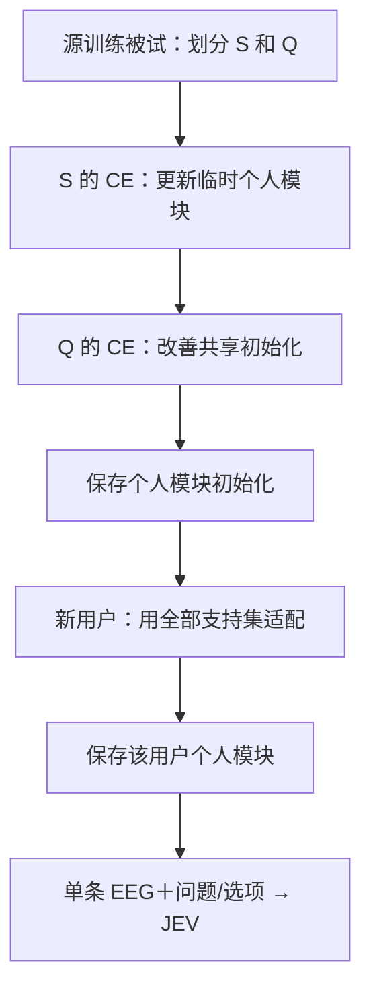

# EEG→JEV 个人少样本适配：文献筛选与方法决策

_2026-11-25；研究建议，尚未实施。检索范围截至当日；不替换当前实验协议，也不改写历史结果。_

---

## 🎯 决策摘要

首选研究主线：冻结共享主干，对个人连接器 LoRA 做 MAML 式元初始化训练，再用新用户自己的全部可用支持样本适配。算法实现优先采用一阶 MAML 近似，限制内外循环的可训练变量为连接器 LoRA。

选择理由是目标吻合，而不是年份、方法复杂度或预期一定涨分：我们需要优化的是“少量个人样本更新后，在这个人另一批数据上的表现”，不是只让支持集 loss 更低。MAML 直接针对适配后的泛化目标；ANIL 提供了只让小部分参数承担快速适配的先例。[^maml] [^anil]

这是对这些范式的迁移，不是原生 ANIL 复现：原 ANIL 的内循环只更新分类头，外循环仍学习特征主干；这里冻结已训练的 Tower/JEV，并把快速变量换成连接器 LoRA。

必须明确的代价：需要额外一次源训练被试上的离线 episodic 训练。它不是现成 checkpoint 上换一个 loss 就完成，也不是让每个新用户重训共享 LM。若不接受这次离线训练，继续使用当前个人 LoRA 是诚实的工程选择；不应把普通微调重新命名为元学习。

这次只敲定优先验证的路线，不宣称它已经优于个人 LoRA，也不宣称“MAML＋EEG”本身构成论文创新。

## 🔍 检索范围与筛选依据

### 如何检索

先按问题检索，再核对具体方法，覆盖以下八类：

1. 有监督少样本迁移：adapter、LoRA、归一化参数更新。
2. 优化式元学习：MAML、ANIL、元正则化。
3. 支持集条件化：CNAPS、TaskNorm、支持集到参数的映射。
4. 保留预训练能力：ProGrad、L2-SP、医学 prompt 学习。
5. 贝叶斯参数适配：BLoB、Laplace-LoRA、2026 Bayesian-LoRA、BAG。
6. 表征干预：ReFT/LoReFT。
7. EEG 原生适配：协方差对齐、跨被试校准、SSL/TTA。
8. 多模态 ICL、上下文压缩/蒸馏与部分个性化联邦学习。

使用通用网络检索定位原文，再通过 PMLR、NeurIPS、CVF、MICCAI、OpenReview 官方论文记录，arXiv 全文，以及 PubMed/出版社记录核验。代表性问题检索包括：

- `EEG few shot subject adaptation foundation model personalization 2025 2026`
- `few shot personalization frozen backbone all support samples negative transfer adaptation`
- `few shot medical vision language model adaptation generalization 2025 2026`
- `few shot adaptation support set conditioning hypernetwork frozen feature extractor`
- `few shot adaptation representation intervention frozen language model multimodal personalization 2025 2026`
- `EEG meta-learning cross-session few-shot`

本轮保存了 35 条问题/方法核验检索词；其中 30 条保留整批返回结果，另 5 条补记检索词。见[检索日志](../artifacts/research/personalization_method_review/search_log.json)。返回结果含重复、二手和无关条目，不能把条目数当成纳入论文数。

这是面向方法选择的范围检索，不是穷尽性的系统综述：没有完整数据库导出、双人独立筛选或可复现的 PRISMA 总分母。会议网页、arXiv 和医学索引提供不同核验渠道，但不冒称做了三个数据库的完整独立检索。没有报告未经核验的引用量。

默认 Parallel 后端没有可用凭据，改用现有网络工具。部分 CVF/OpenReview 全文访问受限，优先使用同题作者 arXiv 全文；没有突破访问验证。文末标明主要阅读深度，摘要级材料不承担关键算法推断。

### 入选标准

优先满足：所有个人支持样本都能参与；支持数量可变；共享 JEV 权重不更新；推理保留单条 EEG＋问题/选项；无需替换成类别原型分类器；所需监督真实可得；已发表方法有可核查原文；附加训练与推理成本可解释。

“LM 冻结”不意味着不能通过 LM 反传。这里允许服务器参与个人训练的前向/反向，但不更新共享 LM 权重。冻结也不自动构成数据隐私保证。

排除首选不等于否定论文。主要排除原因是目标、监督或部署条件不匹配，而不是文章不够新。

## 📚 候选比较

以下“适配判断”是针对本项目的推断，不是原论文已验证的 EEG→JEV 结论。

| 范式与代表工作 | 发表依据 | 原工作主要机制 | 对本项目的判断 |
| --- | --- | --- | --- |
| MAML／ANIL | ICML 2017／ICLR 2020 | 学习易于少步适配的初始化；ANIL 缩小内循环更新范围 | 首选主线；最直接对应个人支持→独立 query 的目标，但有离线成本 [^maml] [^anil] |
| Task-specific Adapters，TSA | CVPR 2022 | 固定通用特征，在支持集上学习任务残差变换 | 支持现有个人 adapter 范式；仅替换模块结构难形成新贡献 [^tsa] |
| CNAPS／TaskNorm | NeurIPS 2019／ICML 2020 | 支持集条件化参数或任务相关归一化 | 很适合免梯度产品化，但需要训练支持集编码器；原分类器不能直接替代 JEV [^cnaps] [^tasknorm] |
| ProGrad | ICCV 2023 | 用预训练预测约束 prompt 的更新方向 | 有价值的保守适配对照；父模型对新用户可能错误，保留旧预测未必有利 [^prograd] |
| ProMetaR | CVPR 2024 | 双层优化学习 prompt 与正则化梯度调节 | 比固定正则更灵活，但原 CLIP 目标/结构需改写；首轮不再加梯度调节网络 [^prometar] |
| L2-SP | ICML 2018 | 惩罚参数偏离预训练起点 | 简洁强对照；不能声称加正则就能消除负迁移 [^l2sp] [^fedalt] |
| BLoB | NeurIPS 2024 | 训练低秩参数后验，而非单一点估计 | 兼容冻结 LM，作为不确定性方向备选；不是已证实的个人 BAcc 提升办法 [^blob] |
| Bayesian-LoRA／BAG | ICML 2026／UAI 2026 | 概率低秩适配；多模态不确定性与资源评测 | 新证据强调小数据 UQ 的价值，也暴露采样推理成本；不据此替代首选 [^bayes26] [^bag] |
| LoReFT | NeurIPS 2024 | 在冻结 LM 指定层/位置干预低秩隐藏表征 | 可做“适配位置”备选；参数高效不等于个人泛化更好，且增加 LM 内部模块 [^reft] |
| BiomedCoOp | CVPR 2025 | 医学 CLIP 的文本 prompt、语义一致性与蒸馏 | 医学标签少的动机相关，但文本相似度决策不同于 JEV；不是直接替换两层 linear [^biomedcoop] |
| 2SFS | CVPR 2025 | 先适配特征，再优化基类线性分类器 | 原方案含类别专属读出，不符合保留统一 JEV 决策的目标；可借鉴训练动态分析 [^2sfs] |
| EEG Euclidean Alignment | IEEE TBME 2020，2019 在线 | 根据被试平均协方差对齐信号 | 生理/统计依据直接，但要核查预处理与源模型是否兼容；不能只在目标端白化就假定有效 [^ea] |
| EEG 参数高效 SSL 适配 | MICCAI 2026 | 无标签目标数据继续自监督，再评估下游读出 | 证明特定 SSL 适配可行；不是本项目有标签个人 CE 的直接替代 [^eegssl] |
| NeuroAdapt-Bench | MLHC 2026 | 对 EEG 基模的多类无标签 TTA 做系统评测 | 常见梯度式 TTA 出现明显退化；不优先把熵最小化/重建作为主线 [^neuroadapt] |
| EEG MDMAML／TCPL | IEEE CIM 2022／Frontiers Neuroscience 2025 | 源被试经验用于快速校准或支持集 prompt | 证明 EEG 个人少样本范式已有先例，也说明不能声称首次把元学习用于 EEG [^mdmaml] [^tcpl] |
| Frozen／MAPL | NeurIPS 2021／EACL 2023 | 映射模态特征至冻结 LM，使用多模态示例推理 | 结构相关；原少样本接口偏 ICL，不满足我们希望部署不携带示例的主线目标 [^frozen] [^mapl] |

### 哪些新证据改变了推荐顺序

BAG 的受控实验提示：一些贝叶斯方法的优势主要出现在不确定性指标；常规准确率可能很接近，完整后验预测又需要多次 LM forward。因此 BLoB 保留为备选，不因“贝叶斯”三个字就排在提高个人分类泛化之前。这里不能把校准收益写成 BAcc 收益。[^bag]

EEG 的 NeuroAdapt-Bench 报告所测 TTA 方法收益不一致，梯度式方法尤其容易退化。这不证明所有自监督适配都无效——MICCAI 2026 的另一工作在不同协议中得到正面结果——而是要求把无标签适配目标与最终 JEV 分类效果分开验证。[^neuroadapt] [^eegssl]

还有一篇 2026 年 EEG 个人校准预印本，在其 CBraMod 流程中没有发现元初始化优于普通继续训练的可靠优势。它同时强调人口模型、本人适配和交换他人适配器的对照。其元学习实验仅覆盖一种主干和特定流程，不能证明元学习普遍无效，但足以否定“元学习必然更好”的先验。本文将其作为风险证据，不作为已录用方法背书。[^personal26]

## 📊 我们已有结果能支持什么

来源：[当前完整汇总](../artifacts/benchmark/leaf_personal_multitask_20261125/summary.json)、[当前协议](PROTOCOL.md)、[个人配置](../configs/personal13.json)。共 21 个用户×任务、两种方法，42 份结果完成。

- 2a 的共享训练未见用户 A06–A09：个人 LoRA 平均 BAcc 从 43.06% 到 50.35%，提升 7.29 个百分点。
- HMC 的四名共享训练未见用户：60.20% 到 69.10%，提升 8.89 个百分点。
- SEED 四人：56.60% 到 55.31%，平均下降 1.29 个百分点；并非所有人下降。
- SSVEP 四人：11.01% 到 10.71%，都接近 12 分类随机水平，不能只用“支持集过拟合”解释。

这些数字分组汇总，没有把已见/未见被试合成泛化均值。2a A06–A07、HMC 部分用户来自原 valid，其余来自原 test；这些集合有历史观察记录。SEED 用户被共享训练见过，SSVEP query 位于原共享训练池。以上均是探索性结果，不是独立盲测估计。

可支持的结论：连接器存在有用的个人适配空间，但收益依任务/用户而异。

尚不能支持的结论：退化一定来自灾难性遗忘、个人噪声一定是主要原因、冻结 Tower 必然最优、元学习一定能修复 SSVEP。表征不足、预处理失配、支持/query 分布差异、优化失败都仍可能存在。

## ⚙️ 推荐方法的精确定义

### 模块放在哪里

保持当前结构：

```text
当前 EEG → 冻结 LEAF Tower
         → 原连接器 + 个人 LoRA
         → 冻结 JEV（仍接收问题、任务文本和选项）
         → 原 choice 输出
```

个人 LoRA 仍在连接器最后一个 `5120→5120` linear，rank 4、40,960 个参数。不是更新 5120×5120 全矩阵，不更新 JEV 内已有 LoRA/决策头。无需新增 G/H、支持集 Transformer、类别原型或长期携带示例。

冻结 Tower 是首轮用于隔离元学习效果、复用当前有效基线的实验选择，不是“EEG 不需要个性化表征”的理论断言。Tower LoRA 可另做匹配消融，但首轮不同时改更新位置。

### 离线阶段：模拟一个人的少样本适配

1. 只从获准用于梯度的源训练数据中选择一名被试，取互不重叠的 `S_s` 和 `Q_s`。
2. 从共享个人模块初始化 `φ₀` 复制一份 `φ_s`。
3. 用 `S_s` 的真实标签、原 JEV choice CE，更新 `φ_s`。
4. 用更新后的 `φ_s` 预测同一人的 `Q_s`。
5. 用 `Q_s` 的 CE 改善初始化 `φ₀`，再换一名源被试重复。

这里 `Q_s` 是原 train 内部的元训练 query，不是仓库原 test/valid，更不是未来目标用户的评估数据。它参与外循环梯度，因此本质仍是训练数据。

训练目标是：

$$
\phi_s = \operatorname{Adapt}(\phi_0,S_s),\qquad
\min_{\phi_0}\;\mathbb E_s\,\mathcal L_{\rm CE}(Q_s;\phi_s).
$$

完整 MAML 对内循环求导；首轮建议用文献已有的一阶近似，不计算穿过内循环的二阶导数。JEV 仍需正常前向和输入梯度，不能声称冻结 27B 就让训练计算免费。[^maml]



源被试依次构成 episode，不是把多人的数据当成同一个人的支持集。最终每个用户只用自己的支持集更新自己的参数。

### 为什么要按时间/场次组织 episode

这是本项目需要验证的设计假设：如果真实部署是前一批个人校准数据到后一批记录，那么源训练的适配练习也应模拟这个变化，而不是随机打散相邻窗口制造过于容易的支持/query 配对。

- 源数据有多场次且均在原 train：优先同人跨场次 support/query。
- 只有单场次：按原始 trial/run 或时间块划分，避免相邻/重叠窗口泄漏。
- 睡眠只能支持同夜前后迁移时，就如实写同夜时序校准，不能称跨夜适配。
- 不为凑 episode 把原 valid/test 移入梯度池；缺少合法源数据时缩小该任务的元训练范围。

利用训练时模拟分布变化有领域泛化元学习先例，但“同人跨记录的 EEG→冻结 LM 接口校准”是这里的迁移假设，效果仍需实验。[^mldg]

### 新用户与部署阶段

新用户有 100 条带标签记录：克隆 `φ₀`，用这 100 条组成的支持池进行 minibatch CE 训练，得到 `φ_u`。支持数量变化不改变模型序列格式；但仍要报告不同样本量下的性能，不能据此宣称对数量变化完全鲁棒。

之后每次只输入一条 EEG＋问题/选项；不提供该条标签，不附加其他人的数据，也不把 100 条示例拼进上下文。JEV 输出仍是原来的选项 logits。

元学习后的初始化本身可能已经提高全局分数。因此必须记录 `φ₀` 未适配时的同人分数，再算 `φ_u` 的增益；不能只与更弱的旧 checkpoint 比较。

## 🧪 最小验证与停止条件

### 三个必要训练臂

| 实验臂 | 离线阶段 | 新用户阶段 | 排除的解释 |
| --- | --- | --- | --- |
| A：现有个人 LoRA | 无额外训练 | 个人 CE | 当前强基线 |
| B：普通训练初始化 | 源 train 上普通 CE 继续训练同样的 LoRA | 同样个人 CE | 是否仅来自额外数据/计算 |
| C：元初始化 LoRA | 源被试 support→query 外循环训练 | 同样个人 CE | 适配后目标是否真正有效 |

每臂都评估个人适配前和适配后。B/C 的比较至少记录并尽量匹配数据暴露、前反向计算总量及墙钟预算；只匹配 outer step 数不公平。原 parent 完全一致。目标用户支持/query ID、rank、模块位置、优化器、学习率、100 步预算、文本与选项处理均保持匹配。

当前个人设置为 AdamW `lr=1e-4`、`weight_decay=0.01`、batch 16、microbatch 4、100 steps、rank 4。研究建议不授权静默改这些参数。元训练新增 outer LR、inner 步数与 episode 预算必须在启动前另行声明；如果源内循环预算不能匹配个人阶段，应明确记录这一近似。

其他检查：

- 固定同人 query 上的 BAcc/Acc、适配增益、每用户变化和负迁移人数；区间按用户而非把相邻窗口当独立样本。
- 交换同任务其他用户模块：看收益是否依赖本人数据；但交换后变差本身不够，还要本人模块优于未适配状态。[^personal26]
- 仅当 C 优于 B，且提高的是适配增益而非仅提高起点，才有元学习证据。
- 不用目标 query 挑 epoch 或给个人模型额外梯度。当前原 test 属开发角色，报告探索性；不把旧 valid 称为从未看过的盲测。
- SSVEP 单独检查信号/标签/表征和支持集可拟合性；无法拟合时不拿它强行支持“少样本过拟合”叙事。

若 C 在匹配的 B 上没有稳定收益，停止扩展这条主线，保留简单个人 LoRA；不继续叠加 TTT、蒸馏、贝叶斯模块来掩盖失败。若主要改善校准而非 BAcc，应转成不确定性问题单独评价，而非偷换当前目标。

## 💡 Motivation、可主张贡献与边界

建议的问题定义：通用 EEG→语言决策模型按群体分类训练，而部署需要有限个人校准后的跨记录泛化。小参数量只限制自由度，并不自动使更新对这个人的未来记录有效。我们研究在共享 LM 不变的条件下，能否把模态连接接口训练成适合个人少样本校准的接口。

这一动机连接三点：群体训练目标与个人部署目标不一致；支持记录与未来记录存在变化；产品需要共享决策主干而非每用户复制/更新大模型。前两点应通过匹配实验和记录级隔离验证，而不是用“EEG 噪声大”笼统代替机制。

论文不能主张：首次个人 EEG 适配、首次 EEG 元学习、首次 LoRA 或首次冻结 LM。已有 EEG 元学习和多模态冻结 LM 文献否定这些宽泛首次声明。[^mdmaml] [^tcpl] [^frozen]

可以检验但尚未成立的贡献：在文本条件化、统一冻结决策器中，适配感知的接口训练是否比普通群体继续训练更能利用个人标签，尤其在同人跨记录迁移中；收益是否确实来自本人支持数据，而非共享模型多训练或额外参数。

仅把现有 LoRA 换成 MAML 初始化，仍然可能创新有限。最终能否支撑论文，取决于上述机制是否成立、与同预算对照的差异、跨任务一致性和真实部署约束下的成本。文献检索可以确定最值得验证的假设，不能替代结果来保证 novelty 或录用。

## 🔗 证据核验与参考文献

阅读深度：MAML、ANIL、ProMetaR、ReFT、BLoB、BAG、2SFS、个人校准预印本核对了全文相关方法/结果段；FedAlt 核对了原文负迁移/正则化段。其余表格候选以官方发表记录、摘要和原作者说明为筛选依据，未声称逐页读完全部全文。ProGrad 的算法细节沿用此前已核对的全文并重新核对发表记录。当前没有用引文数排名或声称任一新论文引用过百。另用技能自带核验器验证本文两个显式 DOI，二者均成功；这不等于自动核验了全部参考文献。见[核验记录](../artifacts/research/personalization_method_review/citation_verification.txt)。

文献综述与文献核查技能使本次补入反面证据、证据分级和检索日志；Markdown 技能用于决策记录与可编辑图。图像生成技能指定后端缺少凭据，未生成 AI 图片，也不将 Mermaid 图冒充 AI 生成图。技能来源仅作工作流归属，不作为方法有效性的证据。[^skills]

[^maml]: Finn, C., Abbeel, P., Levine, S. (2017). Model-Agnostic Meta-Learning for Fast Adaptation of Deep Networks. ICML. [官方论文与全文](https://proceedings.mlr.press/v70/finn17a.html).
[^anil]: Raghu, A., Raghu, M., Bengio, S., Vinyals, O. (2020). Rapid Learning or Feature Reuse? Towards Understanding the Effectiveness of MAML. ICLR. [会议论文](https://openreview.net/pdf?id=rkgMkCEtPB)；[作者全文](https://arxiv.org/html/1909.09157v2).
[^tsa]: Li, W.-H., Liu, X., Bilen, H. (2022). Cross-domain Few-shot Learning with Task-specific Adapters. CVPR. [论文](https://openaccess.thecvf.com/content/CVPR2022/papers/Li_Cross-Domain_Few-Shot_Learning_With_Task-Specific_Adapters_CVPR_2022_paper.pdf).
[^cnaps]: Requeima, J., et al. (2019). Fast and Flexible Multi-Task Classification using Conditional Neural Adaptive Processes. NeurIPS. [官方记录](https://proceedings.neurips.cc/paper/2019/hash/1138d90ef0a0848a542e57d1595f58ea-Abstract.html).
[^tasknorm]: Bronskill, J., et al. (2020). TaskNorm: Rethinking Batch Normalization for Meta-Learning. ICML. [官方记录](https://proceedings.mlr.press/v119/bronskill20a.html).
[^prograd]: Zhu, B., et al. (2023). Prompt-aligned Gradient for Prompt Tuning. ICCV. [官方记录](https://openaccess.thecvf.com/content/ICCV2023/html/Zhu_Prompt-aligned_Gradient_for_Prompt_Tuning_ICCV_2023_paper.html).
[^prometar]: Park, J., Ko, J., Kim, H. J. (2024). Prompt Learning via Meta-Regularization. CVPR. [官方记录](https://openaccess.thecvf.com/content/CVPR2024/html/Park_Prompt_Learning_via_Meta-Regularization_CVPR_2024_paper.html)；[作者全文](https://arxiv.org/html/2404.00851v1).
[^l2sp]: Li, X., Grandvalet, Y., Davoine, F. (2018). Explicit Inductive Bias for Transfer Learning with Convolutional Networks. ICML. [官方记录](https://proceedings.mlr.press/v80/li18a.html).
[^fedalt]: Pillutla, K., et al. (2022). Federated Learning with Partial Model Personalization. ICML. [全文，尤其个人退化及正则化分析](https://proceedings.mlr.press/v162/pillutla22a/pillutla22a.pdf).
[^blob]: Wang, Y., Shi, H., Han, L., Metaxas, D., Wang, H. (2024). BLoB: Bayesian Low-Rank Adaptation by Backpropagation for Large Language Models. NeurIPS. [会议全文](https://proceedings.neurips.cc/paper_files/paper/2024/file/7d53575463291ea6b5a23cf6e571f59b-Paper-Conference.pdf).
[^bayes26]: Lin, M., et al. (2026). Bayesian-LoRA: Probabilistic Low-Rank Adaptation of Large Language Models. ICML. [官方记录](https://proceedings.mlr.press/v306/lin26j.html).
[^bag]: Samplawski, C., et al. (2026). Bayesian Adaptation Gym: A Benchmark for the Bayesian Low-Rank Adaptation of Multi-Modal Language Models. UAI. [官方记录](https://proceedings.mlr.press/v337/samplawski26a.html)；[作者全文](https://arxiv.org/html/2606.22188v1).
[^reft]: Wu, Z., et al. (2024). ReFT: Representation Finetuning for Language Models. NeurIPS. [会议记录](https://proceedings.neurips.cc/paper_files/paper/2024/hash/75008a0fba53bf13b0bb3b7bff986e0e-Abstract-Conference.html)；[作者全文](https://arxiv.org/html/2404.03592v3).
[^biomedcoop]: Koleilat, T., et al. (2025). BiomedCoOp: Learning to Prompt for Biomedical Vision-Language Models. CVPR. [官方记录](https://openaccess.thecvf.com/content/CVPR2025/html/Koleilat_BiomedCoOp_Learning_to_Prompt_for_Biomedical_Vision-Language_Models_CVPR_2025_paper.html).
[^2sfs]: Farina, M., et al. (2025). Rethinking Few-Shot Adaptation of Vision-Language Models in Two Stages. CVPR. [官方记录](https://openaccess.thecvf.com/content/CVPR2025/html/Farina_Rethinking_Few-Shot_Adaptation_of_Vision-Language_Models_in_Two_Stages_CVPR_2025_paper.html)；[作者全文](https://arxiv.org/html/2503.11609v1).
[^ea]: He, H., Wu, D. (2020; online 2019). Transfer Learning for Brain-Computer Interfaces: A Euclidean Space Data Alignment Approach. IEEE TBME 67(2):399–410. [PubMed](https://pubmed.ncbi.nlm.nih.gov/31034407/)；[DOI](https://doi.org/10.1109/TBME.2019.2913914).
[^eegssl]: Dani, M., Liebe, S. (2026). Parameter-Efficient Self-Supervised Adaptation for EEG-FM under Fixed Computational Budgets. MICCAI. [官方论文与评审记录](https://papers.miccai.org/miccai-2026/0756-Paper4755.html).
[^neuroadapt]: Lee, G. J., Pradeepkumar, J., Sun, J. (2026). Test-Time Adaptation for EEG Foundation Models: A Systematic Study under Real-World Distribution Shifts. MLHC. [官方记录](https://proceedings.mlr.press/v340/lee26a.html).
[^mdmaml]: Li, S., Wu, H., Ding, L., et al. (2022). Meta-Learning for Fast and Privacy-Preserving Source Knowledge Transfer of EEG-Based BCIs. IEEE Computational Intelligence Magazine 17(4):16–26. [出版社记录](https://ieeexplore.ieee.org/abstract/document/9942685)；[DOI](https://doi.org/10.1109/MCI.2022.3199622).
[^tcpl]: TCPL: task-conditioned prompt learning for few-shot cross-subject motor imagery EEG decoding. (2025). Frontiers in Neuroscience. [全文与出版记录](https://pmc.ncbi.nlm.nih.gov/articles/PMC12682862/).
[^frozen]: Tsimpoukelli, M., et al. (2021). Multimodal Few-Shot Learning with Frozen Language Models. NeurIPS. [官方记录](https://proceedings.nips.cc/paper_files/paper/2021/hash/01b7575c38dac42f3cfb7d500438b875-Abstract.html).
[^mapl]: MAPL: Parameter-Efficient Adaptation of Unimodal Pre-Trained Models for Vision-Language Few-Shot Prompting. (2023). EACL. [官方记录](https://aclanthology.org/2023.eacl-main.185/).
[^personal26]: Tao, X., Chen, K. (2026). Separating personal from population gains when calibrating EEG foundation models for new users. arXiv 预印本，未核实录用。 [全文](https://arxiv.org/html/2609.34801v1).
[^mldg]: Li, D., Yang, Y., Song, Y.-Z., Hospedales, T. M. (2018). Learning to Generalize: Meta-Learning for Domain Generalization. AAAI. [会议全文](https://cdn.aaai.org/ojs/11596/11596-13-15124-1-2-20201228.pdf).
[^skills]: Kassis, T., Agarwal, V., He, Y., Patel, D., Brueckner, A. M. (2026). Scientific Agent Skills: A Library of Procedural Knowledge for Research Agents. [元数据记录](https://arxiv.org/abs/2609.00065).
