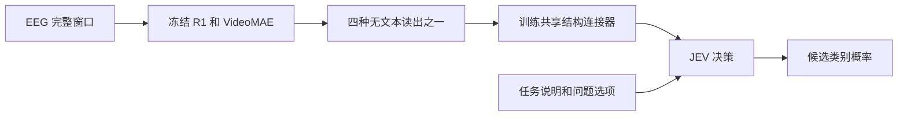

# BSR-VideoMAE → JEV：四种读出的匹配试验

日期：2026-10-30。状态：先制定协议、验证实现，再由控制器启动四卡试验。配置以 [benchmark_train.json](../configs/benchmark_train.json) 为准；旧 LEAF 方案完整归档于 Git `741fe34`。本轮不新增独立的旧方案副本。

## 🎯 要回答的问题

1. What is the problem? 能否把已经在 EEG 频谱视频上训练的 BSR-VideoMAE 接到 JEV，保留跨任务决策所需的信息，同时显著减少输入 token？
2. Why is it important? 同一信号接口可由 JEV 的任务文本和候选项控制输出，不再分别给 EEG 编码器和 JEV 两套文本条件。
3. Why is it hard? 原始 patch tokens 多，信号单位、通道覆盖、窗口时长差异大；新连接器学习失败也可能被误认为编码器无效。
4. Prior limitations? LEAF 的原生路径有文本条件 Q-Former；历史多库训练未充分收敛且协议不完全匹配论文。VideoMAE 则没有预训练 CLS，不能把第一个 patch 当作 CLS。
5. Proposed components? 冻结发布 BSR 信号→频谱视频→VideoMAE，四种无文本读出，共用连接器和原生 JEV 初始化，只在 JEV 提供任务说明、问题和随机重排选项。

这是一项接口／性能验证，不把“替换 encoder”“输出 JSON”或已有 Q-Former 结构本身当作方法 novelty。

## 🔌 单入口文本架构

BSR 权重：`eegckpt/BSR-VideoMAE-AS-Final-v3/ckpts/B1_regen_21e31e56baf2.pt`，SHA256 `21e31e56baf23c0d5446e750ac4eb54a5032d4fe34d2845788e6d22c373bba36`。只载入 `encoder_state`、`renderer_state`、`adapter_state`，不载入发布分类 heads。旧 `q_bias/v_bias` 等价转换为当前 Transformers 的 query/value bias，key bias 为零，严格校验所有键及形状。

每个 ≤10 秒片段生成 16 帧、224×224 的频谱视频，VideoMAE 输出 `[B,1568,768]`。较长窗口均分为有序片段后拼接 tokens，并添加固定分段位置编码：15 秒窗口 3136 tokens，30 秒窗口 4704 tokens；不裁掉尾部。最后压缩的是整个窗口，而非每个片段各输出 32 个 token。

| GPU | 读出 | 输出 token 数 | 精确定义 |
| --- | --- | ---: | --- |
| 0 | mean_pool | 1 | 对全部有效 tokens 取均值；无读出参数 |
| 1 | cls | 1 | 新可学习 CLS 接在编码后的 EEG tokens 前，经过一层双向 self-attention＋FFN，取 CLS 输出 |
| 2 | cross_attention | 32 | 32 个可学习 query，一层 cross-attention＋FFN |
| 3 | qformer | 32 | 4 层 query self-attention＋cross-attention＋FFN，反复读取同一 EEG memory |

CLS 不是 VideoMAE 原生 token，也没有插入已冻结 VideoMAE 的 12 层内部。Q-Former 风格模块从随机初始化训练，不加载 BLIP-2 权重，也没有 BLIP-2 的文本输入或三项预训练损失。[BLIP-2 原论文](https://proceedings.mlr.press/v202/li23q.html)、[VideoMAE 无 CLS 的维护者说明](https://github.com/huggingface/transformers/issues/21016)。

四组读出宽度均为 768；连接器都是 LN→Linear(768,5120)→GELU→Linear(5120,5120)。初始化时单独固定共同模块随机种子并记录参数哈希。读出参数量、token 数与计算量不同，因此不能把最终分差全部解释为某一个结构因素。1-token 两组与 32-token 两组分别比较，并记录实际参数量、耗时、显存。

## 📥 输入与数据划分

保持原有 9 benchmark＋8 train-only，共 17 库。9 库：2a、PhysioMI、SEED、SEED-VII、TUAB、TUEV、HMC 本地子集、Workload、ADFTD；8 个额外库：BNCI2015001、BNCI2014008、BNCI2014009、CHB_MIT、SleepEDF、AlexMI、Zhou2016、Nakanishi2015。2b 不训练。

冻结清单：`artifacts/benchmark/multitask_splits_20261029_final/summary.json`，SHA256 `042520e32bf63b304dba955184757adb53db5b661d39f617601ee78c831b1545`。沿用原始缓存和只排除无效训练窗的 QC：有效 train 953,425，valid 49,069，test 49,431。具体窗口与被试数量见 [结果表](RESULTS.md)。只读取索引审计测试分配，不在当前训练入口进行测试集模型前向。

输入适配规则：

- 统一 200 Hz、微伏，不使用 LEAF 的逐窗 IQR 归一化，也不做新的标签依赖缩放。九个 benchmark 缓存及 SleepEDF 为 V，乘 1e6；其他额外缓存为 uV，不缩放。源文件依据分别为 `prepare_multitask_signals.py` 中 MNE `get_data()`、邻库 SleepEDF/tool.py 的 MNE 读取、MOABB 的 `dataset.unit_factor=1e6`、CHB_MIT 显式 `units='uV'`、Nakanishi 原 pickle 的 `unit='uV'`。源代码和样本数量级相互核对，但旧 PKL 的原始构建环境尚未完整追溯。
- T3/T4/T5/T6 对应 T7/T8/P7/P8；缺失网格通道置零，不做 LEAF 65 通道插值。PhysioMI 的 T9/T10/IZ、TUAB 的 A1/A2/T1/T2、TUEV 的 A1/A2 超出发布 69 通道网格，明确排除并在 `input_audit.json` 记录。其他未知通道直接报错。
- HMC、SleepEDF、CHB_MIT 保留已有最小范数双极表示约定；这不是恢复真实单极电压。HMC 的 M1/M2 不作为网格信号。
- STFT 使用发布实现：200 点矩形窗、center=True、幅值谱、按长度选 hop，再经 R1、SharedScale 和 ImageNet normalization。对 161 点 P300 窗不存在正好 16 帧的整数 hop，最小右侧反射补 4 点到 165 点；原始 161 点全部保留。此补边及短窗边界效应属于明示的迁移限制，不宣称完全等于预训练分布。

## 🧪 训练与选模

- 四组各占一张 H100，seed=42，2040 次优化更新，全局 batch=16、microbatch=2。17 库每周期随机轮转一次，库内类别均衡、被试均匀再抽窗口；四组逐步 sample IDs 和选项排列相同。每库共 120 个 batch／1920 次样本呈现，远少于覆盖全数据集的一个 epoch。
- 第 1–340 步只更新读出和连接器；第 341–2040 步同时更新原生 JEV LoRA 和 choice 头。JEV 主干、BSR 三部分及其 buffers 始终冻结。前阶段关闭 JEV 参数梯度，但保留对连接器的反传；优化器不会对冻结参数施加 weight decay。
- AdamW，weight decay=.01，梯度裁剪 1；连接器／读出峰值 1e-4，JEV LoRA 5e-6，choice 头 1e-5。各组从自身启用步起 warmup 62 步、cosine 衰减至峰值 2%。冻结范围、参数量、梯度范数逐组记录。
- 文本包含任务说明、问题、候选类别和末尾 `[decision]:`；训练随机排列候选项，重排只由 sample ID、step 和 seed 决定，不取决于真值。标签只作为损失目标，不能进入编码器或构造 query。
- loss 为有效候选位置的交叉熵。每步记录所属数据集、loss、batch Accuracy、梯度、LR、显存与样本哈希；batch Accuracy 不是固定模型完整训练准确率。
- 从 step 0 起，每 340 步评估固定 valid ≤512 窗／库和固定 train ≤128 窗／库。新验证子集包含原先固定随机 128 窗，剩余按类别／被试轮转固定补足，保证小类覆盖；单独输出 legacy128 指标用于历史对照。子集 Accuracy 不能冒充完整验证 Accuracy。
- 主选模指标：九库等权平均验证 BAcc，分数相同保留更早步；辅助输出 Accuracy、CE、每类混淆矩阵、每被试指标。每组结束加载自己的 best checkpoint，执行完整九库验证并保存逐窗预测。当前入口禁止 test 前向；先完成四组验证再确定测试方案，避免用测试结果选读出。
- smoke 为四组各 17 个实际更新、每步 2 个训练样本，覆盖全部库及两阶段，检查梯度、冻结 BSR、磁盘重载。正式训练重新初始化，不继承 smoke 权重。代码／配置有 live hash guard，检查点含可训练参数、buffers、Adam 状态和 RNG；支持未完成单组恢复。

单 seed 是 pilot，不足以证明稳定胜出。窗口不是独立被试重复；后续确定方案后应做多 seed、以被试为单位的不确定性估计。硬件卡号和方案目前固定，必要时轮换卡或重复运行核实耗时差异。

## ⚠️ 结果解释与回退条件

不把本轮称为 zero-shot：下游仍用各 benchmark 的训练被试；发布 BSR 的 Stage B 清单包含 PhysioMI、2b、Cho2017、Lee2019_MI 等，Stage A 的精确重叠仍待审计。HMC 冻结 109/151 本地子集、TUAB/TUEV 19 个候选共享 ID（其中 5 个跨库训练／测试冲突）及旧缓存来源风险继续保留。

历史 LEAF 只用于同一缓存／划分上的参考，编码器是否微调、文本输入位置、读出、预处理和训练阶段都改变了；不能据此直接宣称 VideoMAE 或 LEAF 架构更好。新验证512与旧验证128也不能直接相减。

若四组在完整验证及 legacy128 指标上均无改善、或少数任务明显崩溃，先检查按任务 loss、固定训练指标、选项绑定及信号单位，再考虑同划分 frozen BSR linear probe，区分“表示不好”与“JEV 接口没学好”。这些诊断不是当前已完成结果，也不自动用测试集决定换模型。

如果回到 LEAF，计划只载入发布 checkpoint 的 EEG `tower` 权重，取进入文本条件 Q-Former 之前的 tokens；不使用原 `TextConditionedQFormer`、MPNet instruction embedding 或类别头。先核对自监督与 instruct 版本中 tower 的训练历史，再选择版本；不直接使用见过目标测试被试的历史 SFT tower。

之后的对比对齐应显式区分：训练时 EEG 分支不接标签文本，文本分支编码任务＋类别语义；同类样本使用多正例，避免把同类 trial 当负例，并用跨被试／跨数据集留出验证。这个文本分支用于训练目标，不等于推理时给 encoder 和 JEV 双重文本条件。当前四组不含这一尚未验证的对比学习阶段。

## 📚 来源与过程说明

- [BSR 官方仓库](https://github.com/yanweifu-sii/BSR-VideoMAE)、[论文](https://proceedings.mlr.press/v306/wang26bt.html)；本地检查点与代码为实际加载依据。
- [BLIP-2](https://proceedings.mlr.press/v202/li23q.html) 仅作为 query 结构参考，不声称复现其预训练。
- 本协议与实现使用 experimental-design、资源检测、Transformers、hugging-science、Matplotlib 和 Markdown 文档技能辅助检查对照与来源边界，不作为实验有效性证据。工具方法参考：Kassis et al. (2026), [Scientific Agent Skills](https://doi.org/10.48550/arXiv.2609.00065)。
