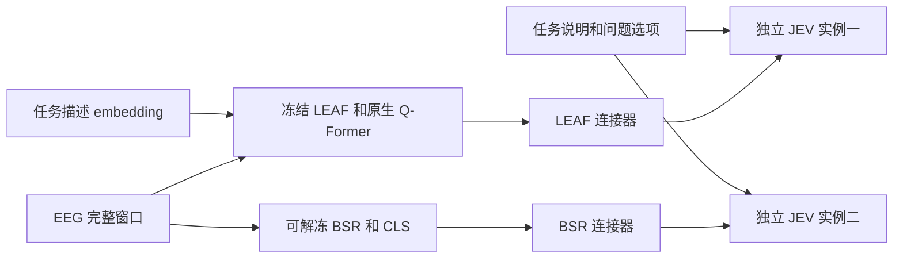

# EEG→JEV：统一划分的适配与少文本对齐试验

_更新：2026-11-01。当前运行 `encoder_adaptation_seedpaper_20261101`，配置见 [benchmark_train.json](../configs/benchmark_train.json)。_

另有用户批准的匹配损失控制 `contrastive_videomae_20261101`，见 [contrastive_train.json](../configs/contrastive_train.json)。复用下文同一数据协议，新增代码位于 `eeg_contrastive/`，不修改正在运行的 `eeg_align/` 及其 hash-guard 配置。

---

## 🎯 要回答的问题

1. What is the problem? 现有 EEG→JEV 的任务表现不均衡，需检验冻结的原生 LEAF 能否保持可读信息，以及 BSR 端到端适配是否有帮助。
2. Why is it important? 避免把连接器训练不足、输入适配或冻结策略的问题，误认为 EEG 基模无法支持多任务语义决策。
3. Why is it hard? 被试、任务、通道数和窗口长度不同；大模型只获得有限更新，输入接口与编码器适配存在混杂。
4. Prior limitations? 历史 LEAF 与 BSR 的冻结策略、文本入口和数据版本不同；历史 SEED 使用跨被试划分，而论文采用被试内 trial 划分。
5. Proposed components? 同一数据清单、采样序列、JEV 初始权重、训练预算及选模规则，运行冻结原生 LEAF 与解冻 BSR+CLS 两组适配控制。

本轮是两种适配方案的可行性试验，不是完整“编码器×冻结状态”2×2 单因素实验。SEED 协议同时改变，不能直接用旧 SEED 分数归因冻结效果，也不把现成连接器结构当作 novelty。

## 🔌 两组结构与冻结范围

| 项目 | leaf_frozen | bsr_unfrozen |
| --- | --- | --- |
| EEG 编码器 | 发布 LEAF instruct MPNet checkpoint | 发布 BSR R1＋SharedScale＋VideoMAE |
| 编码器适配 | 全程冻结，包括原生 Q-Former、BN buffers | 1–340 步冻结，341–2040 步解冻前向路径 |
| EEG 读出 | 原生任务条件 Q-Former，每 ≤10 秒 8×256 token；长窗拼接 | 新学习 CLS＋一层 self-attention/FFN，全窗口输出 1×768 |
| 连接器 | LN→Linear(256,5120)→GELU→Linear(5120,5120) | LN→Linear(768,5120)→GELU→Linear(5120,5120) |
| 文本入口 | 任务描述的固定 MPNet embedding 进入 LEAF；完整问题选项进入 JEV | 文本只进入 JEV |
| GPU | 4 | 5 |



BSR 解冻包含 `renderer.eeg2pix`、SharedScale `log_gain/bias` 和整个 VideoMAE；不训练未参与前向的 `renderer.pix2eeg` 重建头。VideoMAE 使用 activation checkpointing。不是仅加 LoRA，也不是只训练最后一层。

CLS 按前一轮 HMC151 完整验证九库平均 BAcc 选择：41.6912%，mean_pool 为 41.6742%；仅差 0.017 个百分点，不宣称显著优势。这里只复用读出结构，CLS、连接器重新初始化，不复用旧下游 checkpoint。

LEAF 路径从 Git `741fe34` 的隔离 worktree 核对，仅保留当前控制所需的适配器，共享现有 sampler、trainer、JEV 和检查点工具，不恢复旧独立训练入口。两组 JEV 初始化完全相同，但连接器输入维度不同，不宣称连接器初始参数一致。

## 📥 数据与划分

17 库不变：9 个 benchmark＋8 个 train-only。2b 不训练。额外训练库仍为 BNCI2015001、BNCI2014008、BNCI2014009、CHB_MIT、SleepEDF、AlexMI、Zhou2016、Nakanishi2015。

只改变 SEED：严格调用 pinned 官方 `SeedBuilder._divide_by_uniform_label` 核对每位被试每次 session 的 15 个原始 trial，按顺序 1–9／10–12／13–15 分为训练／验证／测试。不是随机切窗口，允许同一被试出现在三份集合，但禁止同一 trial 跨集合。此规则与论文附录 B.3 一致。[^bench]

下表是本轮实际处理窗口及划分，不是论文作者当次运行名单；窗口不能一概视为独立原始 trial。

| 数据集 | 处理窗口：总计（训／验／测） | 任务种类（分类数） | 划分协议 | 被试：总计（训／验／测） |
| --- | --- | --- | --- | --- |
| BCIC-IV-2a | 5,184（2,880/1,152/1,152） | 运动想象（4 类） | 固定跨被试 | 9（5/2/2） |
| PhysioMI | 9,837（6,210/1,734/1,893） | 运动想象（4 类） | 固定跨被试 | 109（69/19/21） |
| SEED | 37,890（22,455/7,875/7,560） | 情绪识别（3 类） | 被试内，原始 trial 顺序 9/3/3 | 15（15/15/15；重复参与） |
| SEED-VII | 19,420（15,536/1,942/1,942） | 情绪识别（7 类） | 随机跨被试 | 20（16/2/2） |
| TUAB | 272,320（247,728/12,315/12,277） | EEG 异常检测（2 类） | 原训练集＋评估集按被试分层 | 2,328（2,075/101/152） |
| TUEV | 113,353（87,834/12,473/13,046） | EEG 事件分类（6 类） | 按被试分层 | 370（328/20/22） |
| HMC | 136,925（92,454/22,421/22,050） | 睡眠分期（5 类） | 完整记录随机跨被试 | 151（103/24/24） |
| Workload | 2,134（1,534/300/300） | 认知负荷（2 类） | 随机跨被试 | 36（26/5/5） |
| ADFTD | 7,013（4,743/1,115/1,155） | AD／FTD／正常识别（3 类） | 按被试分层 | 88（64/11/13） |

SEED 原始 trial 为 675（405/135/135），来自 45 份 session 记录。处理窗口总数不变。其余 16 库 manifest、records 和信号索引逐文件不变，HMC 已补齐 151 份并维持现有 103/24/24 名单。

- 划分：`artifacts/benchmark/multitask_splits_seedpaper_20261101`；summary SHA256 `9a4d302b25413d5e06f728e6fd9caad7b1b3dbf1590e1e7d03121dd2cc19a222`
- 缓存：`datasets/multitask_seedpaper_20261101`；只重建 SEED 索引，全部信号只读链接原缓存，不重写 EEG
- QC：`artifacts/benchmark/multitask_signal_quality_seedpaper_20261101`；summary SHA256 `45e504a715cc5fdbd42b78a28d0edddc735f139063c985af55cd5f0bc236b98c`
- 新 QC 继承已核验的原信号完整性审计，检查源报告哈希、所有数组大小／mtime、SEED 无无效窗及重新分配后的计数；未声称本次重新扫描全部波形
- 17 库有效训练 967,281 窗，九库验证 61,327 窗，九库测试 61,375 窗；仍只排除 CHB_MIT 已知 1,144 个无效训练窗
- 严格校验非 SEED 被试不重叠，以及 SEED 原始 event ID、trial 完整覆盖、窗口身份唯一与 9/3/3 分配；不能全局关闭泄漏检查

重划分入口：[prepare_seed_trial_split.py](../scripts/prepare_seed_trial_split.py)。旧目录保留；禁止拿旧下游 SFT 权重在新划分上继续训练，因为部分样本角色已改变。

## 🔧 输入适配与共同训练设置

LEAF 保留原来的 65 通道插值、逐窗稳健 IQR 归一化、SEED/SEED-VII 插值后裁剪 ±10、200 Hz 和 ≤10 秒分段／100 点补齐。MPNet embedding 仅含任务描述，不含本 trial 类别；来源为已校验的 `multitask_text_20261029`。

BSR 保留已验证的微伏单位、69 通道网格、发布 200 点矩形窗 STFT 幅值谱、16 帧、SharedScale 和 ImageNet 归一化，不采用 LEAF 的 IQR 或 65 通道插值。≤10 秒输出 1568×768；15 秒、30 秒分别拼接 3136、4704 个 token，再由 CLS 汇总。保留原始样本，不截断尾部；短 P300 窗仅按现有规则右侧反射补齐。双极信号的最小范数表示不是恢复真实单极电压。

共同设置：

- 单 seed=42；2040 步，全局 batch=16，microbatch=8，评估 microbatch=8
- 17 库周期随机轮转，库内类别均衡、被试均匀后抽窗口；逐步 sample IDs 和选项排列相同
- 每库 120 个 batch／1920 次样本呈现，不是完整训练 120 个 epoch
- 1–340 步只更新连接器及可训练读出；341–2040 步开放 JEV 原生 LoRA、choice 头；BSR 同时开放前向编码器，LEAF 仍冻结
- JEV 大模型基础权重始终冻结。连接器／读出 LR 1e-4，JEV LoRA 5e-6，choice 头 1e-5，BSR 编码器 1e-6
- AdamW，weight decay=.01，clip norm=1；每个参数组自开放日起 warmup 62 步，再 cosine 衰减至峰值 2%
- 两组从发布权重重新开始，独立 JEV 实例；不继承 smoke 或旧微调参数
- 实际可训练参数量、梯度范数、样本 ID 哈希、LR、loss、batch Accuracy、显存、耗时写入每组日志
- 测试集不参与训练、选模和本轮自动评估

## 📊 验证、恢复与启动门控

从 step 0 开始记录验证；每 340 步评估固定每库 ≤512 验证窗、≤128 训练监控窗。以九库等权平均验证 BAcc 选 checkpoint，同分保留更早步。最终加载 best checkpoint 跑完整 61,327 窗验证并保存预测。训练 batch 指标不等于完整训练集准确率。

两组共用当前 `eeg_align.train_joint` 和 `scripts/run_benchmark.py`。控制器先检查指定 GPU 空闲、2040 步全部计划输入，再运行每组 17 步完整 JEV smoke，覆盖全部数据集并跨过缩短的冻结阶段。必须验证 LEAF 参数／buffers 不变，BSR 开放阶段存在梯度及实际权重变化，磁盘重载 logits 一致，然后正式重新初始化。任一失败不启动后续阶段；保留另一独立任务，不抢占其他 GPU。

代码／配置有运行期哈希保护；未完成的单组可用 `--resume` 恢复，但必须保持源码、配置、数据及检查点身份不变。不要一边运行一边改动导入模块或配置。控制器脱离终端继续执行；节点掉线后需先核实再恢复。

```bash
laya/.venv-eeg/bin/python -m pytest -q tests
laya/.venv-eeg/bin/python scripts/run_benchmark.py --start
```

输出 `artifacts/benchmark/encoder_adaptation_seedpaper_20261101/`。控制器状态为 `pipeline.json`，实时进度为 `train/<arm>/progress.json`，逐任务曲线在两组完成后自动生成。已有输出目录不可重复启动。

启动阶段曾用 microbatch=2 检查两组，均在第 9 步主动安全停止，峰值显存分别约 52.5/54.3 GiB；未进入正式训练。为利用显存余量改为 microbatch=8，并从发布权重重新执行全部预检和 smoke。早期记录完整保留于 `encoder_adaptation_seedpaper_20261101_micro2_smoke`，不当作完成的 17 步 smoke，也不拼入正式训练曲线。

## 🔬 VideoMAE 少文本对齐控制

用户 2026-11-01 指定两组都用 VideoMAE，分别比较多正例 InfoNCE 与多正例 Sigmoid。目标是判断有限类别描述下哪种监督更有利于 EEG 表征；不是宣称模板改写产生新生理信息，也不是原版 CLIP/SigLIP 的复现。

### 模型、文本与配对

两组都从同一发布 BSR 权重开始，沿用上文微伏、STFT、SharedScale、全窗口分段输入，以及新学习的 CLS 读出；不把第一个 patch 当作原生 CLS。CLS 后为 LN→Linear(768,768)→GELU→Linear(768,768)，L2 归一化得到对齐向量。全程训练 `eeg2pix`、SharedScale、VideoMAE、CLS、投影；重建专用 `pix2eeg` 冻结。没有 JEV、没有向 EEG 分支输入答案文本。

文本为本地固定 MPNet（`artifacts/benchmark/mpnet`，权重 SHA256 `78c0197b6159d92658e319bc1d72e4c73a9a03dd03815e70e555c5ef05615658`）的 masked-mean＋L2 embedding。CPU 离线编码，核对旧任务描述参考向量后缓存；训练时文本端完全冻结。每个“任务说明＋规范类别”生成三种固定句式，49 个规范类别组合、147 条文本。句式不是独立 trial 注释；不编造 ERD、脑区或被试属性。

- 同一候选类别的三条文本全部为正例；其他候选类别的文本为负例
- 候选集使用该数据集任务定义的全部类别，不依赖 batch 出现哪些类别，不采其他任务负例
- 相同任务和类别跨数据集共享文本索引；不按原始数字标签跨库匹配，例如 HMC/EDF 的 REM 编号不同
- 仅显式合并 SleepEDF 的 `N3 sleep (stages 3 and 4 combined)` 与 HMC 的 `N3 sleep`；不同任务的 resting 不合并，不把 SEED negative 与 SEED-VII sadness/fear 直接合并
- EEG 样本之间不直接充当负例，也不额外做 EEG–EEG 对比；同类不同被试分别对齐共同文本

### 两种精确定义的损失

令归一化 EEG 为 z，候选文本为 t，分数 s=α·cos(z,t)+b；α 从 1/0.07 初始化，学习后限制在 [1,100]。每条 EEG 的正例集合 P 包含三种句式，负例 N 仅为同一候选集其他类别文本。

| GPU | 实验 | 每个 EEG 的损失 | 特殊参数 |
| --- | --- | --- | --- |
| 6 | infonce | 对 P 内每项计算 -log softmax(s)，然后求平均 | b 固定为 0 |
| 7 | sigmoid | 0.5×mean(P, softplus(-s))＋0.5×mean(N, softplus(s)) | b 从 0 学习 |

这是 EEG→固定文本库单向损失，不是双向 batch 对角线匹配。InfoNCE 使用 SupCon 风格的平均 log 概率，而非 log 的正例总概率，要求所有表述都对齐。[^supcon] Sigmoid 借鉴逐对 logistic 目标，但修改了语义正例和正负权重；未直接套用原始大批量 SigLIP 的偏置设置。[^siglip] 两者微批梯度累积等价于整批，因为候选库固定。

InfoNCE 在三个等价正例情况下存在 log(3) 的损失下界；Sigmoid 不同，因此不能用两组 loss 的绝对大小判定优劣。单文本原型时 InfoNCE 等价于文本权重余弦分类 CE；尚未加入无文本分类／随机原型控制，不能单凭本轮证明自然语言语义带来收益。

### 共同预算、评价和启动门控

- 17 库及全部窗口／被试划分完全沿用上表；2b 不训练，SEED 被试内，其他八个 benchmark 跨被试；额外八库仅训练
- seed=42，2040 步，global batch=32，microbatch=8；每库 120 个 batch、3840 次呈现，总计 65,280 次，不是覆盖全部训练窗的一轮 epoch
- 共享现有类别均衡／被试均匀 sampler，两组逐步样本 ID 一致；第一步起解冻 EEG 前向路径，不含 JEV 连接器预热阶段
- AdamW，encoder LR 1e-5，CLS／投影／scale-bias LR 1e-4；weight decay .01（scale/bias 为 0），102 步 warmup＋cosine 至 2%，clip norm 1；BF16 activation、FP32 参数与文本相似度
- 每组额外的可学习 sigmoid bias 仅一个标量；其余初始化和优化预算相同。这是预先固定超参的单 seed pilot，不是每种损失调到最优后的结论
- 两组都按三条文本的平均 cosine 取最大类别；不将 sigmoid 值或 softmax 分数声称为校准概率
- step 0、每 340 步运行同一 ≤512/库验证及 ≤128/库训练监控；按九库等权验证 BAcc 选 best，同分保留较早模型；最后 best 跑完整 61,327 窗验证，不打开测试集
- 全部计划输入先经 CPU 检查；再在 GPU 6、7 分别执行 17 步真实 smoke，覆盖所有库，检查 encoder 实际变化、固定文本不变和磁盘重载分数精确一致；正式训练重新加载发布权重
- 保存逐步 loss、Accuracy、样本哈希、学习率和梯度；保存 step 0 起验证、每个验证节点 checkpoint、最后完整验证预测和 768 维对齐表征，支持后续曲线及表征检查

入口 `laya/.venv-eeg/bin/python scripts/run_contrastive.py --start`；输出 `artifacts/benchmark/contrastive_videomae_20261101/`。`pipeline.json` 为控制器，`train/infonce/progress.json` 与 `train/sigmoid/progress.json` 为实时阶段。断点单组可用 `python -m eeg_contrastive.train --arm <arm> --out <原目录> --bank-root <运行根目录> --resume`，但需核实无存活同组进程且代码／配置／文本库／数据身份一致。控制器不会自动从失败状态覆盖重启。

这一步学到的是 MPNet 文本空间，不等于直接对齐 JEV 隐空间。后续接回 JEV 的收益尚未验证；当前有监督多库设置仍不能称为跨数据集 zero-shot。已接受的 TUAB/TUEV 候选重合及预训练污染风险不因本轮对比学习而解决。

## ⚠️ 解释边界与历史对照

这是有监督多任务试验，不是跨数据集 zero-shot。SEED 为被试内，其余八个 benchmark 为跨被试，不能把九库一概称作跨被试。

两组在原生预处理、文本入口、token 数和连接器宽度上仍不同；本轮缺少同新划分的 LEAF 解冻和 BSR 冻结两个格子，因此不能单独量化冻结的因果效应。后续若需要严格归因，补齐相同协议的 2×2 控制，而不是将旧分数当作匹配基线。

TUAB/TUEV 的 19 个候选重合 ID（5 个跨库角色冲突）、基模预训练被试重叠、额外缓存来源风险仍未解决。HMC 151 份完整性已解决，但论文作者当次随机被试名单未取得，处理窗口分母不全相同，不声称完全复现论文。

旧冻结 BSR 四读出结果及 LEAF 成绩只保留为必要历史对照，见 [RESULTS](RESULTS.md)。旧表征图见 [REPRESENTATION_ANALYSIS](REPRESENTATION_ANALYSIS.md)，仅描述旧划分／旧 checkpoint，不是新实验结果。旧实现的隔离复现规则见 [ARCHIVE](ARCHIVE.md)。

## 📚 来源与过程说明

本轮使用实验设计、资源检测、hugging-science 和 Markdown 文档技能检查混杂、启动门控与审计记录；不作为模型有效性证据。相关方法工具说明见 Kassis 等的 Scientific Agent Skills。[^skills]

少文本对齐控制使用资源检测、hugging-science、Transformers 和 Markdown 文档技能核验本地模型加载、固定文本来源与运行记录；保留现有环境，不安装／升级依赖，不把技能目录视为模型效果证据。

[^bench]: Xiong et al. EEG-FM-Bench，附录 B.3。https://arxiv.org/html/2508.17742v3#A2.SS3 。实现固定于 xw1216/EEG-FM-Bench commit `325398d7d057ecc1216fb3510d70c16eb60337cc`：https://github.com/xw1216/EEG-FM-Bench/blob/325398d7d057ecc1216fb3510d70c16eb60337cc/data/dataset/seeds/seed.py 。

[^skills]: Kassis, T., Agarwal, V., He, Y., Patel, D., & Brueckner, A. M. (2026). Scientific Agent Skills: A Library of Procedural Knowledge for Research Agents. https://doi.org/10.48550/arXiv.2609.00065 。

[^supcon]: Khosla et al. (2020). Supervised Contrastive Learning. https://arxiv.org/abs/2004.11362 。

[^siglip]: Zhai et al. (2023). Sigmoid Loss for Language Image Pre-Training. https://arxiv.org/abs/2303.15343 。
