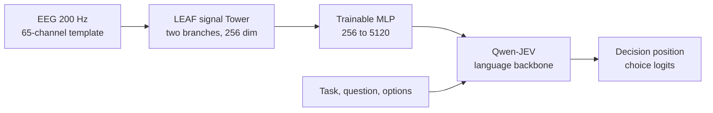

# LEAF 信号 Tower → MLP → Qwen-JEV

_2026-11-23；一个共享模型，四卡同步数据并行。配置：[benchmark_train.json](../configs/benchmark_train.json)。_

---

## 🎯 要回答的问题

1. What is the problem? 检验不经过 LEAF 文本条件化 Q-Former 的信号 token 能否直接适配 JEV。
2. Why is it important? 把信号提取与任务语义处理分开，避免 MPNet 与 Qwen 两套文本接口混用。
3. Why is it hard? Tower 的信号特征空间并不天然等于 Qwen 的输入空间，且跨库通道、时间长度和标签存在差异。
4. Prior limitations? 历史 LEAF→JEV 保留了 FiLM/Q-Former；VideoMAE 控制改变了信号表示路径。旧成绩不能直接归因为本轮结构的优劣。
5. Proposed components? 发布 LEAF Tower、可训练 MLP、原生 Qwen-JEV 语言主干与决策接口；任务文本只进入 JEV。

本轮是有监督多任务适配验证，不是严格 zero-shot，不将通用连接器本身宣称为 novelty。不额外增加对比学习阶段。

## 🔌 模型与初始化



仅实例化原始 `Tower`，从发布 instruction-tuned checkpoint 的 `tower.*` 严格加载；不实例化 MPNet、FiLM 或 Q-Former。删去从不进入信号前向的 mask token 与两个重建输出头。Tower 使用共享时空 tokenizer、双向和因果 Transformer，各 12 层，输出拼接为 256 维 token。[^leaf]

- 权重：`/inspire/hdd/global_user/zhangchenxi-253108310322/LEAF/checkpoints/leaf-v1.0-instruct-mpnet-base.ckpt`
- SHA256：`f9ca9cabbd734d2691fa6748adf3e78056f895d4031f7edc481e7d7b6822f3fa`
- 连接器沿用两层 MLP 形式：LayerNorm(256) → Linear(256,5120) → GELU → Linear(5120,5120)
- JEV 从原生语言权重、原生 LoRA 和 choice 行初始化；不加载视觉塔，不继承旧下游 SFT 权重
- 输入序列沿用 `prefix + EEG tokens + task/question/options + [decision]:`；真实标签仅用于监督
- 文本位于 EEG 后面，因果主干的决策位置可读取二者；不声称前面的 EEG 位置能反向看到后面的任务文本

4 秒 EEG 输出 16 个 token，10 秒输出 40 个；长窗按既有规则均匀切成不超过 10 秒的片段，各片右侧补到 100 样本整数倍，保留全部片段和两个分支，不做池化或 token 压缩。30 秒 HMC 窗共有 120 个 token。

信号预处理复用历史 LEAF：双极导联最小范数表示（不等于恢复真实单极 EEG）、去无几何的乳突参考、200 Hz、每窗 0.1/99.9 百分位截幅、median/IQR 标准化（IQR 为零时用 std）、65 通道插值，SEED/SEED-VII 保留原额外 ±10 截幅。所有阶段 Tower 保持 eval 模式，禁用 dropout 并固定 BatchNorm buffers，但预热后可计算梯度和更新 affine/Transformer 参数。

## 📥 数据与划分

17 库不变：9 个 benchmark＋8 个 train-only。2b 不训练。额外训练库仍为 BNCI2015001、BNCI2014008、BNCI2014009、CHB_MIT、SleepEDF、AlexMI、Zhou2016、Nakanishi2015。

沿用上一阶段的 SEED 划分：严格调用 pinned 官方 `SeedBuilder._divide_by_uniform_label` 核对每位被试每次 session 的 15 个原始 trial，按顺序 1–9／10–12／13–15 分为训练／验证／测试。不是随机切窗口，允许同一被试出现在三份集合，但禁止同一 trial 跨集合。此规则与论文附录 B.3 一致。[^bench]

下表是本轮实际处理窗口及划分，不是论文作者当次运行名单；窗口不能一概视为独立原始 trial。

| 数据集 | 处理窗口：总计（训／验／测） | 任务种类（分类数） | 划分协议 | 被试：总计（训／验／测） |
| --- | --- | --- | --- | --- |
| BCIC-IV-2a | 5,184（2,880/1,152/1,152） | 运动想象（4 类） | 固定跨被试 | 9（5/2/2） |
| PhysioMI | 9,837（6,210/1,734/1,893） | 运动想象（4 类） | 固定跨被试 | 109（69/19/21） |
| SEED | 37,890（22,455/7,875/7,560） | 情绪识别（3 类） | 被试内，原始 trial 顺序 9/3/3 | 15（15/15/15；重复参与） |
| SEED-VII | 19,420（15,536/1,942/1,942） | 情绪识别（7 类） | 随机跨被试 | 20（16/2/2） |
| TUAB | 272,320（247,728/12,315/12,277） | EEG 异常检测（2 类） | 原训练集＋评估集按被试分层 | 2,328（2,075/101/152） |
| TUEV | 113,353（87,834/12,473/13,046） | EEG 事件分类（6 类） | 按被试分层 | 370（328/20/22） |
| HMC | 136,925（92,454/22,421/22,050） | 睡眠分期（5 类） | 完整记录随机跨被试 | 151（103/24/24） |
| Workload | 2,134（1,534/300/300） | 认知负荷（2 类） | 随机跨被试 | 36（26/5/5） |
| ADFTD | 7,013（4,743/1,115/1,155） | AD／FTD／正常识别（3 类） | 按被试分层 | 88（64/11/13） |

SEED 原始 trial 为 675（405/135/135），来自 45 份 session 记录。处理窗口总数不变。其余 16 库 manifest、records 和信号索引逐文件不变，HMC 已补齐 151 份并维持现有 103/24/24 名单。

- 划分：`artifacts/benchmark/multitask_splits_seedpaper_20261101`；summary SHA256 `9a4d302b25413d5e06f728e6fd9caad7b1b3dbf1590e1e7d03121dd2cc19a222`
- 缓存：`datasets/multitask_seedpaper_20261101`；只重建 SEED 索引，全部信号只读链接原缓存，不重写 EEG
- QC：`artifacts/benchmark/multitask_signal_quality_seedpaper_20261101`；summary SHA256 `45e504a715cc5fdbd42b78a28d0edddc735f139063c985af55cd5f0bc236b98c`
- 新 QC 继承已核验的原信号完整性审计，检查源报告哈希、所有数组大小／mtime、SEED 无无效窗及重新分配后的计数；未声称本次重新扫描全部波形
- 17 库有效训练 967,281 窗，九库验证 61,327 窗，九库测试 61,375 窗；仍只排除 CHB_MIT 已知 1,144 个无效训练窗
- 严格校验非 SEED 被试不重叠，以及 SEED 原始 event ID、trial 完整覆盖、窗口身份唯一与 9/3/3 分配；不能全局关闭泄漏检查

重划分入口：[prepare_seed_trial_split.py](../scripts/prepare_seed_trial_split.py)。旧目录保留；本轮从发布 LEAF 权重初始化，不使用任何历史下游 checkpoint。


## 🔧 训练与四卡语义

| 项目 | 固定设置 |
| --- | --- |
| GPU | 0、1、2、3，四个模型副本，共享一次同步更新 |
| 全局 batch | 16；每 rank 4，microbatch 4；不是全局 64 |
| 总预算 | 2040 次优化器更新，seed 42 |
| 步 1–340 | 仅训练 MLP 连接器 |
| 步 341–2040 | LEAF Tower 全参、连接器、JEV 已有 LoRA、choice head |
| 永久冻结 | JEV 基础参数；LEAF BatchNorm buffers |
| 学习率峰值 | connector 1e-4；JEV LoRA 5e-6；head 1e-5；Tower 1e-6 |
| 优化器 | AdamW，weight decay 0.01，梯度裁剪 1 |
| 学习率日程 | 各组开放后 62 步预热，cosine 至峰值的 2% |
| 损失 | 候选类别交叉熵，无新增 InfoNCE/Sigmoid |
| 验证 batch | 每 rank 至多 8；不改变样本集合或统计权重 |

四个 rank 从同一确定性全局采样列表切分，不独立重新抽样；训练 loss 按本 rank 样本数归一化后 all-reduce 平均梯度，再裁剪、更新。逐步核对全局 ID 顺序，保存时核对所有 rank 的可训练权重哈希。沿用已有显式 all-reduce 数据并行实现，并由四进程等价性测试验证；不采用 tensor/model parallel。

17 库周期随机轮转，库内类别均衡／被试均匀。每库 120 个 batch、1920 次样本呈现，全部 32,640 次样本呈现，并非完整遍历 967,281 个训练窗。增加 GPU 不放大学习率或训练量。

## 📊 验证、恢复与启动

step 0 和每 340 步记录每库至多 512 个固定验证窗，以及至多 128 个训练监控窗。九库等权验证 BAcc 选 best，同分保留较早 step。结束后 best 做完整 61,327 窗验证；测试前向固定为 0。训练监控不冒充完整训练集准确率。

验证按原始样本索引跨 rank 划分，汇总全部概率后计算 confusion matrix/Acc/BAcc，不平均各卡 BAcc，不重复补齐尾批。完整验证保存逐窗 ID/标签/概率。结束自动绘制 loss、验证及分库曲线。

启动顺序为 CPU 全部计划输入检查 → 四卡 17 步 smoke（含预热后梯度、权重同步、重载、训练子集分布式评估）→ 重新从发布权重初始化正式训练。smoke 不访问验证/测试，参数不得流入正式 run。每 20 步保留 last，验证点另存 checkpoint；保存完整 Adam 状态、buffers 和四 rank RNG。源码、配置、上游模型代码与 checkpoint 身份受保护，不允许 live job 期间修改。

```bash
laya/.venv-eeg/bin/python -m pytest tests -q
laya/.venv-eeg/bin/python scripts/run_benchmark.py --start
# 中断后仅恢复同一配置、源码、四 rank 的未完成 checkpoint：
laya/.venv-eeg/bin/python scripts/run_benchmark.py --start --resume --gpus 0 1 2 3
```

输出：`artifacts/benchmark/leaf_tower_jev_20261123/`。查看 `pipeline.json` 与 `train/leaf_tower_mlp/progress.json`；失败信息为 `failure_rank*.json`。原 checkpoint/log/cache 不覆盖。使用四卡验证并行，不另启动四组不同实验。

## ⚠️ 解释边界

本轮与之前 VideoMAE 不构成“只改一个模块”的严格消融：encoder、输入适配与 token 长度均不同。与历史 LEAF 还存在 HMC/SEED 协议、验证选模等区别。所有学习率/global batch/步数沿用当前既定值，不因换成四卡而放大。

SEED 被试内，其余八个 benchmark 跨被试。TUAB/TUEV 的 19 个候选共享 ID、其中 5 个跨库角色冲突未解决；LEAF 预训练/指令调优数据重叠未排除。HMC 151 份已补齐，但作者精确随机名单未确认。不能声称完全复现 EEG-FM-Bench 或严格无泄漏。

旧方案已归档到 `6247e46`，只在隔离 worktree 复现；当前工作树不保留独立的 VideoMAE/对比学习训练分支。历史产物位置见 [ARCHIVE](ARCHIVE.md)，历史成绩保留于 [RESULTS](RESULTS.md)。

## 📚 来源

[^leaf]: LEAF 作者原始实现和说明。https://github.com/Jiang-Muyun/LEAF/blob/main/LEAF.py 。本轮以本地来源文件哈希为准，不自动更新上游。
[^bench]: EEG-FM-Bench 附录 B.3 与固定提交。https://arxiv.org/html/2508.17742v3#A2.SS3 ；https://github.com/xw1216/EEG-FM-Bench/blob/325398d7d057ecc1216fb3510d70c16eb60337cc/data/dataset/seeds/seed.py 。
