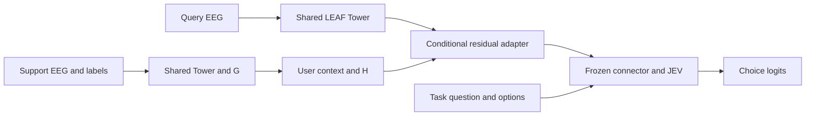

# 用户条件化 EEG→JEV：当前实验协议

2026-11-23。配置：[personalization.json](../configs/personalization.json)。当前替换个人梯度适配入口，旧状态归档到 `05403f7`。旧权重、日志、取消标记保留，不恢复已取消的批次。

## 研究问题

1. What is the problem? 能否让冻结的JEV服务利用新用户少量带标签EEG改善判断，而不为每人训练LM或运行个人优化器？
2. Why is it important? 模型与推理接口保持共享，用户只缓存上下文，减少个人训练与版本维护成本。
3. Why is it hard? 跨被试/session的信号分布改变；适配后的特征必须保持对冻结JEV可读。support拟合好不保证query泛化好。
4. Prior limitations? 文本相似度适配与JEV目标不同；逐用户CE需要反传；开放语言LoRA没有在单用户pilot改善query。本轮不预设冻结Tower最好，也不以引用量代替EEG证据。
5. Proposed components? 集合编码G、FiLM参数映射H、共享残差adapter、冻结JEV query CE；用是否更新Tower的配对控制检验信号表征是否需要共同适配。

## 结构与范式

采用CNAPS-inspired的amortized feature adaptation，不是原CNAPS完整复现。DeepSets提供排列不变集合编码，FiLM提供条件化特征调制；不复制原CNAPS的分类器生成/度量读出，最终仍使用JEV。[^cnaps] [^sets] [^film]



对于support集合S：

```text
z_i = E(x_i)                                  # [16,256], four-second MI
r_i = element([mean_tokens(z_i), label_proj(t_yi)])
u   = context(mean_support(r_i))               # [128], support order invariant
(gamma,beta) = H(u)                            # [64] each
A(z,u) = z + W_up GELU((1+gamma)*W_down z + beta)
logits = JEV(connector(A(E(x_query),u)), task/question/options)
```

G：标签投影768→64，element MLP320→128→128，均值聚合后MLP128→128。H：MLP128→128→128，后64＋64分别为gamma/beta。adapter下投影256→64，上投影64→256；上投影权重/bias零初始化，step0精确等于父模型。G/H与adapter合计189,440参数。

标签向量复用锁定的MPNet类别文本库（每类三个模板取均值），仅用于support真实标签，不给query输入真实类别。不做cosine/最近原型分类，不为数据集新增专用分类矩阵；候选类别数仍受JEV既有choice接口限制，不能承诺无限类或未知任务零样本能力。

新用户u、gamma、beta会变，但G/H和adapter权重不变。离线训练允许Tower共同学习；部署期两组均冻结全部参数，只计算support上下文再应用到query。这不是逐用户LoRA、TTT或MAML内循环。

## 两组唯一的干预

| GPU | 组别 | Tower权重 | G/H＋adapter | JEV base/LoRA/connector/head |
| --- | --- | --- | --- | --- |
| 0、1 | tower_frozen | 冻结 | 更新 | 全冻结 |
| 2、3 | tower_full | 全参更新 | 更新 | 全冻结 |

两个rank同步平均梯度，不是每卡不同seed。Tower保留19,557,632个前向参数，两组均eval，BN buffers/dropout固定。全参组同时通过support/query分支更新同一个Tower。JEV不进优化器，但训练forward不能包no_grad，否则前端拿不到CE梯度。

父checkpoint：`artifacts/benchmark/leaf_tower_contrastive_20261123/train/leaf_infonce_mlp/best.pt`，验证选中step1360；包含已完成文本对齐＋共享SFT的Tower、连接器、语言LoRA/head。不是从发布Tower重新训练，也不继承个人adapter。连接器为LN256→Linear256,5120→GELU→Linear5120,5120。JEV只加载语言主干，不加载视觉塔。

## 数据与support/query

下表为父模型原划分的处理窗口/被试数，不是本轮全部评估人数。原文件和划分均不改写；每个MI event一个四秒输入窗。

| 数据集 | 处理窗口：总计（原训／验／测） | 任务种类（分类数） | 原划分协议 | 被试：总计（原训／验／测） |
| --- | ---: | --- | --- | ---: |
| BCIC-IV-2a | 5,184（2,880/1,152/1,152） | 运动想象（4类） | 固定跨被试 | 9（5/2/2） |
| PhysioMI | 9,837（6,210/1,734/1,893） | 运动想象（4类） | 固定跨被试 | 109（69/19/21） |

- 仅原训练的5＋69名被试参与优化。每两步各抽一次数据集，库内随机打乱被试后轮转，每步一人；两组使用同一落盘episode流。
- 2a：T session support池，E session query池。身份为session＋run＋event，六个run重置event不能混同。
- PhysioMI：R04/R06/R08/R10 support池，R12/R14 query池，不在同一个record切两池。
- 每步support每类5条共20条；query每类4条共16条，无放回。不同step可再次抽到原trial，不算新增数据。
- 固定验证：原valid的2a被试6与PhysioMI被试70；每类5条support，独立query池全量评估。按数据集等权BAcc选checkpoint，包含step0，同分保留早者。
- 最后仅原test的2a被试8，support/query ID与旧5-shot/seed42 pilot完全相同：T支持20条、E查询288条。无测试梯度、无测试选模，无多被试/shot/seed扫参。
- 原数据/QC索引与父checkpoint核对；按窗固定200Hz、分位截幅、median/IQR标准化、65通道表示，不拟合query分布。每输入65×800，输出16×256。
- 复用 `multitask_splits_seedpaper_20261101`、`datasets/multitask_seedpaper_20261101` 及对应QC。父模型17库共享训练，本轮只做两个MI任务的机制验证。

## 固定预算与审计

| 项目 | 设置 |
| --- | --- |
| 更新 | 每组340步；seed42；不是340个epoch |
| support | 每类5条，共20条；每个episode一名用户 |
| query batch | 全局16 = 两rank各8；microbatch4，累积2次 |
| 损失 | query的JEV四分类CE；无额外对比、重建或support拟合损失 |
| G/H/adapter LR | 1e-4，沿用前轮小模块LR |
| Tower LR | 全参组1e-6，沿用共享SFT；不因双卡改变 |
| 优化器 | AdamW，weight decay0.01；每参数组独立clip1；恒定LR |
| 验证 | step0、85、170、255、340；固定support，完整query |
| 断点 | 每20步和末步last，保存optimizer/RNG；best按验证选 |
| GPU短测 | 各4步源训练episode，仅valid子集前向，不访问test |

340步为预定机制验证预算，不代表收敛；每组5,440次query呈现。每microbatch重算support图，两卡复制相同support；梯度平均等价性有自动测试。记录query loss、梯度范数、耗时、显存、验证。

门控检查：相同初始Tower/adapter哈希、同一episode流和step0基线；JEV参数版本/buffers不变；Tower冻结组不变/全参组改变；G/H/adapter均更新；双rank权重相同；checkpoint重载实际logits完全一致。短测权重不传入正式实验。

选中checkpoint后，评估正确用户support、固定源训练用户support、u=0、绕过adapter四种前向条件。错误用户为同库第一名源训练被试，不根据效果挑选。后两者诊断共享残差偏置/共同Tower变化；这是推理消融，不代替从头训练的无条件adapter控制，不能单独证明个性化机理。

## 启动和解释边界

入口 `scripts/run_personalization.py --start`，输出 `artifacts/benchmark/leaf_amortized_film_20261123/`。输入准备、两组GPU短测通过后自动并行正式训练。查看 `pipeline.json` 和各组 `progress.json`；最终预测保存到 `test_*_predictions.pt`。源码/配置/输入/父checkpoint受运行期哈希保护，未取消的意外中断才允许 `--resume`。

旧个人adapter的64.93%含100步个人更新；本轮多了共享G/H训练、目标用户不更新，不是等预算对照。单个已被观察的test用户仅作探索，不能称盲测、跨被试显著提升或产品有效性。Tower全参可能损害非MI任务，本轮未验证多任务保留能力。LEAF预训练重叠、原TUAB/TUEV候选身份冲突仍未解决。

实验设计技能用于配对episode、固定预算与数据边界；Markdown技能用于保持当前协议一致。工具方法来源：Kassis et al. (2026), [Scientific Agent Skills](https://doi.org/10.48550/arXiv.2609.00065)。本轮G/H维度及EEG接入是工程设计，不是引用论文已验证的EEG方法。

[^cnaps]: Requeima et al., Fast and Flexible Multi-Task Classification Using Conditional Neural Adaptive Processes, NeurIPS 2019. [原论文](https://proceedings.neurips.cc/paper_files/paper/2019/file/1138d90ef0a0848a542e57d1595f58ea-Paper.pdf)。
[^sets]: Zaheer et al., Deep Sets, NeurIPS 2017. [原论文](https://papers.neurips.cc/paper/2017/hash/f22e4747da1aa27e363d86d40ff442fe-Abstract.html)。
[^film]: Perez et al., FiLM: Visual Reasoning with a General Conditioning Layer, AAAI 2018. [原论文](https://cdn.aaai.org/ojs/11671/11671-13-15199-1-2-20201228.pdf)。
