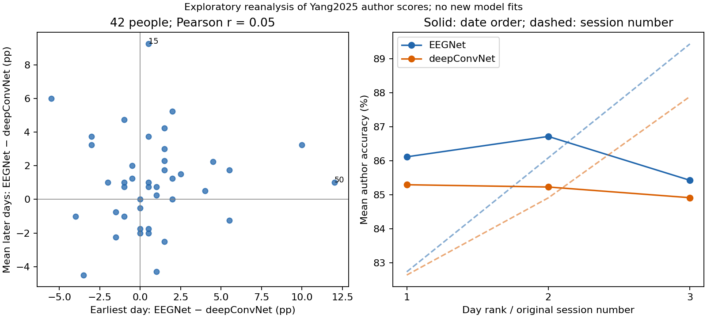

# 作者结果复核：个人优势的重复性依赖比较对象

2026-10-25。对 Yang2025 作者公开分数的**探索性二次分析**，没有重新训练模型。计划见 [AUTHOR_SCORE_AUDIT.md](AUTHOR_SCORE_AUDIT.md)，更正计算代码于 Git `90e88b4` 提交后运行。

**更正说明：此前把处理后会话编号直接对应到原始同名编号，导致错误日期重排。旧解释已撤回并归档于 Git `a4cf3c0`。现已验证全体会话映射，以下全部数字、图形和结构化结果均由更正程序重算；原定队列、统计量和选择规则不变。**

## 1. 分数与数据来源

通过 HTTP Range 读取作者 65.63 GB ZIP 的目录和相关片段，没有下载整个归档。取得 30 个代码/文本文件，包括 result.csv，并验证 ZIP CRC。独立 pandas 解析与主脚本的 csv 解析对全部 765 个分数一致。

完整 51 人×3 会话的五模型均值分别为 CSP 61.12%、FBCSP 67.46%、EEGNet 85.32%、deepConvNet 84.47%、FBCNet 78.40%，与论文报告的两位小数均值一致。这支持分数版本一致性，不等于复现了训练过程。[原始论文](https://doi.org/10.1038/s41597-025-04826-y)、[作者数据](https://doi.org/10.25452/figshare.plus.22671172)

## 2. 已验证会话映射与日期

NEMAR v1.0.5 的 153 个信号头全部取得，并与全部 153 个原生事件文件头核对：日期全部一致，时钟相差 0–2 秒。25/51 人的**原始**编号不按记录时间递增，但不能据此重排作者的处理后分数。

读取全部 153 个处理后 MAT 的完整 200 项任务标签，与原始 evt.bdf 的有序任务标签匹配。51 人均存在唯一的三会话对应，全部为完整序列相等。25 人的原始/处理后编号不同；映射后的**处理后编号全部按记录时间递增**。MAT 标签尾部读取器与 sub-1 三个完整、CRC 校验通过的 MAT 逐标签一致。其三个会话首试次的波形抽查也支持对应：近似处理后通道相关中位数约 0.90–0.92；这不是全部 EEG 波形的精确复现。

9 人（12、16、19、21、22、29、39、41、51）的三个会话只有两个不同日期，仍按先前元数据规则排除，主分析为 42 名三日被试。排除不依赖模型表现。按头时间计算，第二次记录距首次的中位间隔约 1.01 天、范围 0.59–44.99 天；第三次约 2.99 天、范围 1.60–46.01 天。因此这里是该队列不同间隔的描述性摘要，不是固定“一天后”或长期稳定性估计。记录时钟未经外部校准，CSV→处理后文件仍依赖作者代码的编号逻辑。

sub-1 首会话全部 200 个 BIDS onset 比原始 evt.bdf 触发统一晚 1.5 秒。其处理后波形更接近原始触发后 [0,4] 秒而非 [+1.5,+5.5] 秒。两套数据包装的窗口不能混用；该检查没有确定任务程序中每种触发的刺激含义，也不证明存在生理边界标注错误。

证据：[完整映射](sources/eeg_trust/yang_session_mapping.json)、[全体原始/转换日期核验](sources/eeg_trust/yang_native_converted_dates.json)、[153 个文件头](sources/eeg_trust/yang_all_session_headers.json)、[标签读取器核验](sources/eeg_trust/yang_label_reader_validation.json)、[波形抽查](sources/eeg_trust/yang_sub1_waveform_audit.json)、[事件比较](sources/eeg_trust/yang_event_audit.json)。

## 3. 全部十个模型对

对每人取最早记录日的准确率差 A−B，与后两日平均差值相关。下表为 Pearson r 及按人 bootstrap 20,000 次的 95% 百分位区间。十个区间是探索性边际区间，不代表同时覆盖，不用于显著性筛选。

| A−B | r | 95% 区间 |
|---|---:|---:|
| CSP−FBCSP | 0.557 | [0.251, 0.776] |
| CSP−EEGNet | 0.683 | [0.432, 0.852] |
| CSP−deepConvNet | 0.665 | [0.438, 0.823] |
| CSP−FBCNet | 0.598 | [0.386, 0.755] |
| FBCSP−EEGNet | 0.670 | [0.428, 0.842] |
| FBCSP−deepConvNet | 0.659 | [0.452, 0.805] |
| FBCSP−FBCNet | 0.587 | [0.359, 0.749] |
| EEGNet−deepConvNet | 0.057 | [-0.169, 0.304] |
| EEGNet−FBCNet | 0.545 | [0.301, 0.732] |
| deepConvNet−FBCNet | 0.601 | [0.396, 0.760] |

重点模型对 EEGNet−deepConvNet 的 Spearman 相关为 0.123，逐人留一后的 Pearson 范围为 [−0.002, 0.090]。最早日差值均值 0.095 个百分点、SD 3.438；后两日平均差值均值 1.363 点、SD 2.664。早期差值有非正态诊断和 IQR 极端值；所有人保留，未按诊断移除。EEGNet 有约 30.2% 的会话准确率达到 95%，需注意天花板效应。

右图是同一 42 人的各日均值，没有训练重复或因果干预，不能将上升归因于学习机制。

**可支持的结论：在这个分数表里，相对优势的观测重复性依赖模型对。** 两个网络间的低相关不能推广到全部解码器。经典与深度模型差值的高相关，也可能来自稳定任务难度、天花板、预处理或其他因素，不等于稳定神经类型。没有逐试次预测、独立评价重复及初始化重复，不能分开真实会话变化与测量噪声。

## 4. 早期选优的回顾式演示

按最早日最高分选择的管线分布为 CSP 1 人、EEGNet 19 人、deepConvNet 17 人、FBCNet 5 人；平局按表列顺序。其他 41 人最早日均值决定的全局选择为 EEGNet 37 人、deepConvNet 5 人。

个人选择对应的后两日平均分为 86.910%，全局选择为 87.569%，差值 −0.660 个百分点，按人 bootstrap 区间 [−1.618, 0.206] 点。事后查看每个未来会话再选优可达 88.785%，比该全局策略高约 1.215 点。

这是**回顾式分数选择演示**：没有用同样历史标签适应模型，原分数采用会话内 CV，不是时间前缀部署评价。区间条件于已观察到的留一全局选择，没有纳入重新抽取开发人群造成的选择不确定性。点估计为负、区间含零；不能据此证明所有个体化方法无效，也不能代替问题定义中的 V(m)。事后 oracle 的空间不能视为已兑现的收益。

## 5. 个人对应关系有信息，不等于选模规则胜过强基线

新增探索性对照于 Git `233bbf1` 固定计算规则后运行。此时已有全部分数与前述结果，不能称独立确认。保持首日各模型被选择的人数不变，只随机交换模型选择与后期用户的对应关系；随机对照取所有置换的精确期望。它比任意均匀选模型更匹配，因为不改变模型组成。

| 候选模型组 | 真实个人选择后期均值 | 交换对应的期望均值 | 个人对应增量（95% bootstrap 区间，百分点） | 首日留一全局选择后期均值 |
|---|---:|---:|---:|---:|
| 全部五模型 | 86.910% | 85.588% | +1.321 [0.323, 2.430] | 87.569% |
| EEGNet/deepConvNet | 87.283% | 87.149% | +0.134 [−0.246, 0.519] | 87.569% |

五模型中真实对应优于随机分配同样数量的模型，但仍比原全局选择低 0.660 点。两网络组比全局选择低 0.286 点（这里只作点估计描述）。因此，**早期比较包含个人匹配信息，与简单选优规则是否值得使用，是不同问题。** 不能由相对全局的负点估计推出个人信息不存在，也不能由正的匹配增量宣称已取得可部署的个体化收益。

20,000 次人员对应置换的双侧参考 p 分别为 0.00170、0.52217；两组 Holm 调整为 0.00340、0.52217；这只调整本项两组比较，不覆盖此前整个探索过程。该推断依赖零假设下对应关系的交换性；不是随机干预，也不能识别神经机制。bootstrap 每次重采样完整用户并重算选择频率及后期模型均值，不把这些量固定为已知。

五模型逐人留一后的匹配增量范围为 0.876–1.429 点；两网络为 0.049–0.202 点。总增量对每人共同的难度加项、每模型共同的分数加项不变，但不能排除非线性的能力、天花板或其他稳定因素。原始各模型协方差贡献会混入共同用户难度，不能逐项解读为某模型的个人化作用；去除用户与模型均值后，其贡献依次为 CSP +0.274、FBCSP 0、EEGNet +0.345、deepConvNet +0.803、FBCNet −0.101 点，只是总量的代数拆分。没有据此挑选新模型组合。

普通置换允许少量用户的原对应保留。若精确期望改为每名接收者只从其他 41 人取得选择，五模型增量为 1.353 点，两网络为 0.138 点；二者均按计划报告，不选择更有利的版本。

独立接收者×选择来源双循环重算效用和排除自身的期望；全部 20,000 次 bootstrap 另行重算。置换均值/方差与解析值相符，方差公式另用小矩阵穷举验证，输入哈希与 Git 代码一致。[结果](sources/eeg_trust/selection_identity_result.json)、[核验与中心化贡献](sources/eeg_trust/selection_identity_verification.json)。这是作者会话内 CV 分数的匹配对照，没有新增预测、历史适应或基模训练；全部原限制继续适用。

## 6. 新颖性和测量限制

Yang2025 已报告多个模型的总体比较及 EEGNet 跨会话个体准确率变化；这些不是新问题。NeurIPS 2024 FALCON §4.2 还讨论了侵入式 M1 数据的跨会话模型排序保持，不能声称首次研究神经解码跨会话排名。[FALCON 原文](https://papers.neurips.cc/paper_files/paper/2024/file/8c2e6bb15be1894b8fb4e0f9bcad1739-Paper-Datasets_and_Benchmarks_Track.pdf)

当前候选限定为：**指定时间跨度与校准预算下，单日个人信息能在多大程度上支持未来模型推荐？** 相关性只是辅助描述，低 Pearson 相关不排除可利用的非线性关系。进一步查重已确认近邻研究实际评价自动选配置，并提出严格时间顺序与预训练表示扩展；不再把这几项组合视为新问题类别。 标准相关、混合效应模型或选择工具不构成方法创新；贡献必须来自尚未被现有工作覆盖的实证发现和同预算未来价值验证。

只有三次测量时，“稳定个人成分”和缓慢变化的会话成分并不自动可分。增加初始化种子也不能解决这项识别问题。可观察的有限时段重复性与依赖额外假设的稳定成分必须分开报告，详见 [测量协议](MEASUREMENT_PROTOCOL.md)。

## 7. 核验与后续条件

独立 pandas 解析全部分数，以 scipy 重算十个相关及 bootstrap 区间、全部 42 个选择差值及区间。51 人映射日期与完整缓存匹配，输入哈希及 Git `90e88b4` 分析脚本验证通过。图形的日期顺序、单位、点与模型颜色已经检查。[结构化结果](sources/eeg_trust/yang_author_score_result.json)、[统计诊断](sources/eeg_trust/yang_author_score_diagnostics.json)、[核验记录](sources/eeg_trust/yang_author_score_verification.json)。

没有新增模型训练，没有访问本地外层保留用户。正式同预算实验仍需锁定有限管线、共同校准/查询试次和历史适应对照，并保存逐试次预测以评估误差。此结果只提供探索性依据，不能替代独立队列验证，也不因某一模型对相关低就挑选它作为确认性主对比。流程使用 statistical-analysis，参考列于 REPORT。
