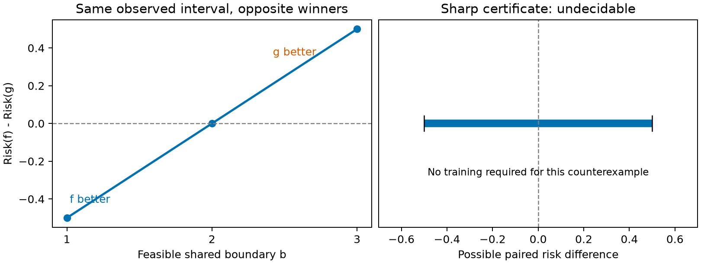

# 2026 会议选题调研：先定义问题，再决定模型

调研截止：2026-10-25。面向不训练基模、不做 VLM、希望以问题定义和可完成的数学结果为贡献的小团队。

**建议优先验证：时序标注不确定性下，模型优劣是否可以被认证。** 具体落点是 ECG 波形分界或动作分段中的“共享边界约束”：同一个真实边界会同时改变许多样本的标签。先研究评价结论是否由数据确定，再研究怎样用少量复核获得确定结论。这个切口能复用已有小模型或缓存预测，第一阶段不需要训练。

这是一项有明确边界的选题调研，不是对全年所有论文逐篇精读的系统综述。七个官方目录共提取了 **25,191 个去重 URL 入口**；这是目录规模，不是人工精读数量，也不是核定后的主会独立论文总数。定向阅读 **54 篇官方论文页面**，另查 CVPR 官方索引、历史先行工作和近期预印本；下载了 9 份可访问全文，其中 8 份进行了定向原文检查，另 1 份仅提取、定位。未把全部下载文件算作已精读。详见 [论文表](PAPERS.md)、[检索与证据边界](SEARCH_METHOD.md)、[问题定义与证明](PROBLEM_DEFINITIONS.md)。

## 1. 怎样判断一个方向值得做

问题定义的创新，至少应该改变以下一项，并说明旧定义为什么不够：

1. **能观察什么**：完整标签变成区间、集合、部分反馈，或已知测量算子而非任意特征。
2. **需要决定什么**：预测单个类别，变成能否宣布模型更好、是否值得增加测量、什么时候应该拒绝下结论。
3. **错误是什么**：平均准确率，变成序列级比较错误、错误认证、或对不可恢复信息的过度自信。
4. **信息要花什么成本**：采集一个样本、核实一个边界、增加一个同步锚点、接通一个传感器的成本不同。

我的筛选标准依次是：真实失败是否可展示；最近工作是否已经定义了同一问题；是否有容易获取的真实观测；能否用小模型/固定预测验证；理论是否回答问题本身；两周内能否发现不值得做。没有按论文题目的新鲜程度或数学符号数量打分。

“低垂果实”在这里指**失败现象和第一个反例容易验证**，不代表投稿容易。完整证明也是必要质量标准，不能自动替代非平凡性和新颖性。下面的三个基础证明都有完整论证，但其中的线性代数、动态规划和区间推断工具本身不是新定理。

## 2. 今年会议里，哪些贡献形态与我们匹配

| 会议 | 官方目录提取入口 | 本次重点 | 对选题的意义 |
|---|---:|---|---|
| NeurIPS 2026 | 9,146 | 参考标注审计、选择性标签、传感器故障、可观测性、风险保证 | 问题定义、负结果和评价协议都有可参考的作品；不同 track 不混作主会理论论文 |
| ECCV 2026 | 2,834 | 坐标奇异性、无标签模型排序、TTA 欠确定性、传感器噪声 | 已有具体视觉失败 + 小修正 + 数学解释的路线 |
| ICML 2026 | 6,628 | 校准迁移、区间删失评分、条件覆盖诊断、延迟结果 | 观测机制和统计目标的变化本身可以成为研究对象 |
| ICLR 2026 | 5,468 | 缺失性下的信息增益、选择后推断错误、部分反馈、EEG TTA | 需要区分经验收益、正确统计对象和严格保证 |
| AISTATS 2026 | 588 | 部分标签可学习性、缺失模式覆盖、层次分类 | 与小算力、明确假设、完整证明的偏好较匹配 |
| COLT 2026 | 197 | 对抗缺失回归、拒答学习、分组采样复杂度 | 理论门槛高；作为下界和定义参照，不宜直接把 minimax 题当低垂果实 |
| UAI 2026 | 330 | 部分识别三元检验、离散化偏差、相关删失评价 | 适合“哪些结论可由有限观测推出”的路线 |
| CVPR 2026 | 未完成完整目录提取 | 低质量多模态自校准；对照 workshop 的边界监督工作 | 官方搜索索引可核验部分论文，实时页面受限，覆盖深度低于上面七会 |

目录来源：[NeurIPS](https://neurips.cc/Downloads/2026)、[ECCV](https://eccv.ecva.net/Conferences/2026/AcceptedPapers)、[ICML](https://icml.cc/Downloads/2026)、[ICLR](https://iclr.cc/virtual/2026/papers.html)、[AISTATS](https://proceedings.mlr.press/v300/)、[COLT](https://proceedings.mlr.press/v336/)、[UAI](https://proceedings.mlr.press/v337/)、[CVPR](https://openaccess.thecvf.com/CVPR2026?day=all)。这些数量不用于推断“小众程度”或年度录用率。

**最值得学的是把旧目标与新目标分开。** 例如 NeurIPS 的 *Announced Breaks Separate Conformal Reliability from Frequency Calibration* 区分单次预测的概率可靠性与长期实现频率；其官方摘要同时报告真实数据中的无收益结果。这提示我们：先精确定义要保证哪个对象，再决定理论和实验应该测什么。[论文](https://neurips.cc/virtual/2026/poster/151358)

**可解释的失败可以比复杂模块更有价值。** ECCV 的 *Coordinate Singularities Break Conformal Coverage for Gaze and Head Pose* 说明坐标图的畸变会影响分组覆盖，而整体覆盖仍可能正常；全文明确指出其局部近似、exchangeability 和异方差限制。不能把它概括为“换成测地距离就获得任意条件覆盖”。[论文](https://eccv.ecva.net/virtual/2026/poster/5387)

**同样需要防止把一个漂亮反例写成过大的结论。** ECCV 的无标签分割模型排序方法以扰动一致性为依据，全文讨论任务不匹配等限制；它给出经验排序证据，并非任意目标分布下的无标签正确性保证。这类边界可以启发课题，但不能凭一个常数预测器反例就声称推翻其经验结果。[论文](https://eccv.ecva.net/virtual/2026/poster/4464)

## 3. 已经不适合直接作为新问题的方向

| 初看像新题的描述 | 最近的直接先行工作 | 我们的判断 |
|---|---|---|
| 缺失模态时仍提供 conformal 保证 | AISTATS *Mask-Conditional Conformal Prediction*；NeurIPS *Beyond Imputation* | 问题已被直接定义。必须提出新的可观测条件、估计误差或资源约束，不能仅换数据集 |
| 无标签把校准迁到新传感器/模态 | ICML *Conformal Calibration Transfer* | 不能把“源有标签、目标只有配对数据”当新设置 |
| 只在模型愿意回答时校准 | ICLR *Online Selective Conformal Inference: Errors and Solutions* | 选择会破坏交换性，已有直接修正；简单套 split CP 不成立 |
| 只观察被选择的标签，认证总体尾部风险 | NeurIPS *Hidden Tails* | 已覆盖非识别、敏感性界、认证成本和有限样本问题，冲突非常直接 |
| 小预算标签认证模型优劣 | 2026-09 预印本 *How Many Labels Does Model Choice Need?* | 已有精确停止、证书与预算。新题必须超出独立未读标签/固定置信排序的结构 |
| EEG 跨蒙太奇/参考变换的可辨识性 | 2026-10 预印本 *GRAFT-EEG* | 已有 reference gauge、观测算子、限制可辨识性和扰动界；不推荐重做通用版本 |
| 滑窗标签与活动粒度不匹配 | NeurIPS *When a Window Is Not an Action*；ISWC 2019 label jitter | 现象本身已不是新问题。可继续研究共享边界下的评价认证，而不是只加边界模块 |
| 检测时间不同步，做 DTW/对齐 | 2026 MDL misalignment 预印本；DTW-certified anomaly detection | 单纯诊断或鲁棒对齐竞争已存在；更窄的问题是对齐是否消除了任务信号 |

出处和阅读深度在 [PAPERS.md](PAPERS.md)。特别是 AISTATS 的 mask-conditional 定理：原文使用分布支撑/绝对连续性条件和相应似然比；实现中的估计权重不能不加说明地继承 oracle 权重下的精确结论。

## 4. 候选方向排序

以下全部是**提案**，不是“已证实无人做过”的发现。小众判断来自任务切口和所需资源，不是 bibliometric 统计。

| 优先级 | 候选问题 | 可能的真正贡献 | 成本估计与主要风险 |
|---|---|---|---|
| A：优先验证 | **共享不确定边界下的时序模型比较与最小复核** | 从固定真值排行榜，转为所有可行标注下是否都支持同一个结论；一次边界复核关联一段标签 | 初检 CPU；已有预测即可。风险是退化为已知证书加常规 DP，必须做出结构性采样/复杂度结果 |
| B：条件保留 | **同步操作何时会抹掉任务相关延迟** | 区分设备偏移与生理/运动时延，给出决策所需同步精度和拒判边界 | 小模型/合成波形；需要真实同步锚点或元数据。工程领域先行工作较多 |
| C：条件保留 | **任务可恢复性驱动的缺失传感器决策** | 研究不恢复完整信号时，某个任务是否已可决定，以及下一次测量的决策价值 | 线性代数 + 小分类器可启动；与 GRAFT-EEG、经典 sensor selection 的冲突高 |
| D：储备 | **无标签模型排序中，哪些少量复核能排除稳定但错误的模型** | 有条件的三元结论：A 好、B 好、证据不足；明确扰动一致性的用途边界 | 模型缓存 + 少量精标；泛化版本与 model-choice certificates 重合，暂不单独立题 |
| E：不优先 | **缺失机制变化后，模态增益到底能否识别** | 从预测分数转到测量的增量决策价值 | ICYM²I、L2M、missingness shift 已很近；MNAR 下还需外部信息，容易假设过强 |
| F：不优先 | **几何/对称性下的结构化不确定性** | 针对错误商空间或错误坐标造成的保证失效 | ECCV 2026 坐标奇异性、ICML 2025 对称姿态已有工作；单纯 S² 换 SE(3) 不足 |

算力估计是工作量判断，不是实测。前三项的数学定义、基础证明和停止条件见 [PROBLEM_DEFINITIONS.md](PROBLEM_DEFINITIONS.md)。

## 5. 推荐课题 A 应该怎样定义

**一句话问题：当专家只能确定事件边界的范围时，现有标注究竟足不足以支持“A 比 B 好”，如果不够，复核哪个边界最值得？**

**观测来源的补充限定：**目前确认可用的是独立专家的边界点，不是经过验证的真值区间。先检验同一标注协议下，模型比较是否依赖参考专家；专家点的最小值/最大值不能自动成为真值界。下面的区间模型须以直接区间标注、明确测量约束或预先声明的容差假设为前提，否则只能解释为对指定参考集合稳健。不同语义协议导致的起止差异，应先统一任务定义。详细区别见 [问题定义 A0](PROBLEM_DEFINITIONS.md#a0-先固定边界的含义与观测来源)。

输入是冻结的候选模型预测、每个序列的标签顺序、允许的边界区间和合法持续时间约束。真实标签序列由一组共享边界产生。输出是模型两两性能差的 sharp 上下界，以及“确定优于/确定劣于/不可判定”；进一步输出需要复核的边界。评价对象是序列或被试，不把重叠窗口当独立样本。

与最接近工作的区别必须严格保留：

- 相对 PSDNet / label jitter：研究的是**测试结论的可辨识性和复核成本**，不是训练时抗边界噪声。
- 相对 fluorescence reference audit：从少数手工 reference 的敏感性分析，进入**所有满足显式时序约束的 reference**，给出可达到的性能差界。
- 相对 Kuboyama 的 model-choice certificates：标签不是独立未知比特，边界查询会同时约束整段时间；必须证明这种关联如何改变证书和查询复杂度。只做 unrestricted completion 公式的时序应用不够。
- 相对 interval-censoring scoring：不拟合一个潜在事件时间分布，也不假定区间内均匀；固定模型比较首先是有限观测的集合识别问题。

**最小可发表贡献目标**应包含：一个真实存在的比较失效；一个有作用的结构约束；一个严格优于忽略结构的界或查询结果；一个真实多标注数据验证。基础 DP 可作为起点，不应独占理论贡献。

### 可用数据与需要先核实的事实

1. **QT Database**：官方文档明确 105 个记录中只有 **11 个**有第二位专家的边界注释。它适合小型真实差异验证，不能宣传为 105 个独立双专家样本；同记录多心拍也不能当作独立被试。[官方说明](https://www.physionet.org/content/qtdb/1.0.0/doc/)
2. **NeurIPS 2026 ECG Dataset with Multi-Expert Annotations and Delineations**：官方摘要给出超过 2,500 个 ECG 记录，1,527 个含详细 PQRST 注释，并由两位心脏科医生核验。“两人核验”不等于“发布了两套独立边界”。这是必须先检查的关键事实。[官方页面](https://neurips.cc/virtual/2026/poster/138906)
3. 找到同名 [Zenodo 数据记录](https://zenodo.org/records/20067223)，约 307.8 MB，API 确认开放访问和 CC-BY-NC-4.0 许可。通过 Range 请求已读取完整 ZIP 目录、README 和元数据表：有 2,732 对 `.hea`/`.dat` 文件，以及 1,527 个 `.ii` 文件。**README 中 doctor1–doctor7 明确指异常诊断标签，并非七套波形边界；每个带分界的记录只列出一个 `.ii` 文件。当前公开结构不支持“独立专家的多套边界已可用”这一假设。** 尚未解析 `.ii` 内容，不能排除文件内部包含额外信息；官方论文页面也未直接链接该地址，所以数据包与论文的对应关系仍需最终确认。检查结果保存在 sources/zenodo_zip_metadata.json。
4. **GTEA / Breakfast / 50Salads** 可做跨领域验证，作者维护的 UVAST 项目提供特征与标签入口，可避免从视频预训练编码器。但单套 hard labels 人工加扰动只能算敏感性实验，不能当成人类真实标注不确定性的证明。[作者项目](https://github.com/boschresearch/UVAST)

因此，A 的推荐是**优先做低成本可行性检查**，不是数据已齐备的正式立项。QTDB 可支撑小型真实标注差异展示；仅凭 11 个记录不能预设能得到精确的跨被试总体结论。若需要更强统计证据，必须获得更多独立重复标注，或把论文主张收缩到有限数据集的条件认证。

### 固定对照与指标

| 必须包含的对照 | 要排除的解释 |
|---|---|
| 原始单标注分数及按独立序列的 bootstrap | 不能只证明普通抽样方差存在 |
| 随机边界抖动 / soft-label 平均分 | 平均一个人为分布，不等于对所有可行真值认证 |
| 逐帧独立 completion 上下界 | 证明共享边界结构确实提供了额外信息 |
| 两模型各自区间相减 | 检验共享同一个真值的 paired 界是否明显更紧 |
| 随机、区间最宽、预测分歧最大的复核策略 | 避免把普通 active learning 改名 |
| 同预算精确解/小规模最优查询树 | 判断启发式是否接近可达到的最好结果 |

主指标：错误宣称优越的比例、不可判定率、差值区间宽度、达到结论的复核成本、随不确定边界宽度变化的稳定性。性能差界先针对固定权重的可加损失；**不能直接宣称同一 DP 精确处理 macro-F1、mAP、segmental F1 或 Edit**。这些指标具有分母或匹配耦合，需要单独推导。

图中结果是解析反例，不是真实数据实验。对应 DP 已与 1,000 个小规模穷举案例交叉检查，包含 400 个不可行约束案例；200 个线性观测例子核验了可达区间端点。见 [数学核验结果](math_checks.json)。

## 6. 两周内先回答什么

这是建议的后续执行协议，当前未启动训练或改动现有 EEG/ECG 实验。

| 时间 | 可交付证据 | 停止/转向条件 |
|---|---|---|
| 第 1–2 天 | 检查数据是否真的包含独立复核、时间单位、record/subject ID；固定 2–3 个已有预测器 | 只有最终共识标签又无法获取独立边界：不得声称真实标注认证，转向可识别集合的理论工作或放弃 |
| 第 3–4 天 | 复现“合法边界可改变模型优劣”的小反例；比较 paired / independent 界 | 真实不确定范围下，排序和差值始终稳定且区间无实际价值：降低优先级 |
| 第 5–7 天 | 审核 DP、约束来源、边界失配；分析查询的结构性收益 | 改进全部来自人为扩大区间或换指标：停止 |
| 第 8–10 天 | 与 Kuboyama 2026 和参考审计逐项对照；推导超出标准 DP 的结果 | 能被最近工作直接重参数化覆盖：停止或重新定义 |
| 第 11–14 天 | 冻结问题陈述、主定理、对照和跨数据验证方案 | 只有“加噪后分数变了”：还不值得开始大训练 |

通过这些检查后，再决定是否需要算法代码。先验上最值得花时间的是**边界查询的关联结构如何改变认证成本**，不是先设计一个更大的分割网络。

## 7. 如何选择理论深度

若以 AISTATS/UAI 为目标，可以从有限样本、可识别集合、严格比较和统计保证进入；若以 NeurIPS/ICML 为目标，需要更一般的结构化信息获取问题和较强理论/跨任务证据；若以视觉会议为目标，则需要真实视觉任务中的普遍失败及对现有评测的实质影响。这里是选题适配判断，不是录用概率预测。

建议把贡献写成这类形式：

> We study model comparison when reference labels are coupled by uncertain event boundaries. We characterize when the comparison is determined by the available annotations, compute sharp pairwise bounds under temporal constraints, and study the annotation cost required to resolve otherwise ambiguous comparisons.

目前这段话是**目标陈述**；其中“annotation cost”的非平凡一般结果尚未建立，真实数据的排序不稳定也尚未验证。不能把本调研中的完整基础证明包装成已经完成的投稿论文。

## 8. 限制与材料

主题检索偏向不确定性、观测机制、评价和时序问题，未覆盖优化、图学习、科学计算等全部小众方向。CVPR 实时访问不完整；部分 OpenReview 全文受访问检查限制，对这些论文只做官方摘要层面的判断。没有把任何预印本写成已录用。候选的新颖性是有边界检索后的判断，不是全世界不存在同类工作的证明。

本次工具辅助流程参考了 literature-review、scientific-brainstorming 和 PDF 技能。过程来源：Kassis, Agarwal, He, Patel & Brueckner (2026), [Scientific Agent Skills: A Library of Procedural Knowledge for Research Agents](https://doi.org/10.48550/arXiv.2609.00065)。它仅为流程来源，不作为科研结论依据。
